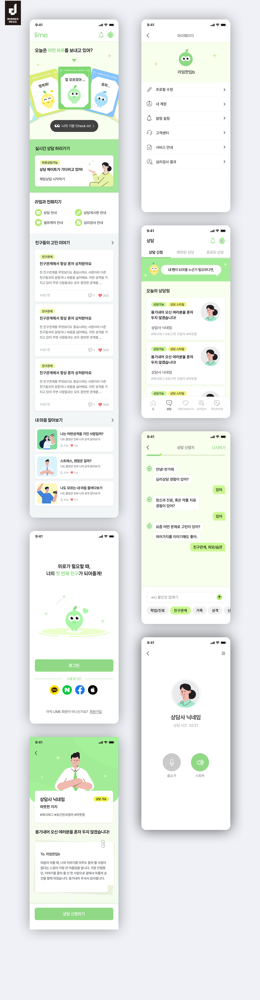

# 라임 청소년 상담 앱 디자인 레퍼런스 분석

## 분석 대상

- [GDWEB 선정작: 라임-청소년 상담](https://www.gdweb.co.kr/sub/view.asp?displayrow=60&Txt_key=all&Txt_word=&Txt_agnumber=&Txt_fgbn=7&Txt_bcode1=&Txt_gbflag=&Txt_bcode2=&Txt_bcode3=&Txt_bcode4=&Txt_bcode5=&Page=1&str_no=26645)
- [원본 시안 이미지](https://www.gdweb.co.kr/sub/filedata.asp?str_no=26645&sgbn=1) · [로컬 캡처](lime-reference.png)
- GDWEB 페이지 표기: 제작사 디트너스, WINNER PRIZE, 등록일 2026년 3월 12일.

이 문서는 GDWEB에 게시된 **정적 모바일 앱 시안**을 분석한다. 실제 앱의 동작, 접근성 구현, 반응형 규칙, 정확한 폰트와 색상 값은 시안만으로 확인할 수 없다. 아래의 수치와 동작 설명은 재현을 위한 추정이다.

## 한눈에 보는 디자인 방향

상담을 무겁거나 병원처럼 느끼지 않도록 **연두색 캐릭터, 부드러운 일러스트, 짧은 문장**으로 진입 장벽을 낮춘다. 홈에서는 감정 확인 → 실시간 상담 → 커뮤니티와 심리검사 순으로 서비스를 소개한다. 긴급 행동인 상담 신청은 녹색 면과 큰 버튼으로 강조하고, 설정과 목록 화면은 흰 배경과 얇은 구분선으로 차분하게 처리한다.

## 시각 언어

| 요소 | 시안에서 관찰한 특징 | 재현 시 권장 사항 |
| --- | --- | --- |
| 색상 | 흰색과 아주 옅은 연두를 바탕으로 선명한 라임 그린을 사용. 노랑과 하늘색은 감정 카드와 작은 태그에만 등장 | 기본 배경 `#FFFFFF`, 옅은 배경 `#F7FDED`, 주요 연두 `#91D886`, 강조 연두 `#A1E990`, 보조 노랑 `#EAF58D`, 문자 `#222222` 정도에서 시작해 원본과 대조하며 조정 |
| 타이포그래피 | 둥글고 읽기 쉬운 산세리프. 섹션 제목과 핵심 문장은 굵게, 설명과 메타 정보는 회색으로 처리 | 한글 UI 폰트 한 종을 정하고 본문 14–16px, 섹션 제목 18–20px, 보조 정보 12–14px 정도의 명확한 위계 구성. 정확한 폰트명은 미확인 |
| 형태 | 둥근 카드, 캡슐형 상태 태그와 버튼, 둥근 캐릭터. 화면 자체도 기기 모형의 큰 라운드 안에 배치 | 카드 반경 약 10–16px, 버튼 약 8–12px, 태그는 완전한 캡슐형으로 통일 |
| 깊이 | 카드에는 얕은 그림자와 옅은 경계선, 기기 모형에는 큰 그림자 | 앱 내부 그림자는 절제하고, 정보 그룹은 배경색과 여백으로 구분 |
| 아이콘/삽화 | 얇은 선 아이콘, 단순한 표정의 과일형 캐릭터, 평면 인물 삽화 | 아이콘 선 굵기와 삽화 채도를 일관되게 유지. 캐릭터는 감정 선택과 안내의 핵심 표식으로 사용 |

색상 값은 캡처 화면을 보고 근사한 **초기 토큰**이다. 원본 디자인 파일에서 추출한 값은 아니다.

## 화면별 구성

| 화면 | 주요 배치와 정보 위계 | 주요 행동 |
| --- | --- | --- |
| 홈 | 로고와 알림/프로필 → “오늘은 어떤 하루를 보내고 있어?” → 부채꼴로 펼친 감정 카드 → 검은색 기분 체크인 버튼 → 연두색 실시간 상담 영역 → 서비스 바로가기 → 고민 글과 심리검사 목록 | 기분 체크인, 상담 채팅 시작, 콘텐츠 탐색 |
| 마이페이지 | 상단 제목 → 연두색 프로필 영역 → 아이콘이 붙은 단일 행 메뉴와 얇은 구분선 | 프로필, 계정, 알림, 고객센터, 검사 결과 관리 |
| 상담 목록 | 제목과 3개 상태 탭 → 캐릭터의 말풍선 안내 → “오늘의 상담원” 카드 목록 → 5개 항목 하단 탭 | 상담원 탐색 및 상담 신청/조회 |
| 상담 신청 전 대화 | 상단 뒤로가기·진행 막대·다시하기 → 메시지형 질문과 답변 → 하단 입력칸과 주제 칩 | 부담이 작은 단계별 정보 입력 |
| 로그인 | 넓은 흰 여백과 캐릭터 → 큰 녹색 로그인 버튼 → 소셜 로그인 4종 → 회원가입 링크 | 로그인 또는 가입 |
| 상담원 프로필 | 큰 녹색 인물 영역 → 상태 태그가 붙은 소개 카드 → 편지 형태의 자기소개 → 하단 고정 상담 신청 버튼 | 상담원 신뢰 형성 및 신청 |
| 상담 통화 | 중앙 프로필 이미지·이름·시간 → 화면 아래쪽의 마이크와 스피커 원형 제어 | 통화 중 오디오 설정 |

## 반복되는 컴포넌트와 흐름

1. **감정 진입점:** 홈의 감정 카드는 색과 캐릭터 표정으로 선택지를 시각화한다. 선택 뒤의 실제 화면은 시안에 없어 구체적인 후속 동작은 확인되지 않는다.
2. **상담 유도:** 홈의 실시간 상담 카드, 상담원 목록, 상담원 프로필의 고정 버튼이 서로 다른 탐색 깊이에서 같은 목표를 안내한다.
3. **낮은 입력 부담:** 상담 신청은 긴 양식 대신 짧은 문답과 주제 칩을 배치한다. 진행 막대가 현재 단계를 알려준다.
4. **상태 표시:** `상담가능`, `상담 스타일`, `바로상담가능` 같은 캡슐 태그로 읽기 전에 상태를 파악하게 한다.
5. **일관된 탐색:** 상담 목록에는 홈·상담·기분 Check-in·심리검사·게시판상담의 하단 탭이 보인다. 다른 화면의 하단 탭 유무는 시안만으로 확정하기 어렵다.

## 구현에 옮길 때의 핵심

- 첫 화면에서는 **감정 체크인과 실시간 상담**을 가장 먼저 보이게 하고, 커뮤니티·검사 콘텐츠는 아래로 이어지게 한다.
- 카드 한 장에는 제목, 상태, 설명, 보조 정보를 담되 한 번에 읽을 수 있는 분량을 유지한다. 상담원 카드와 고민 글 카드는 동일한 카드 톤을 공유한다.
- 녹색은 상담 신청, 현재 선택 상태, 진행 상황에 집중해서 사용한다. 일반 목록은 흰색으로 두어 주요 행동의 대비를 살린다.
- 상담 서비스 특성상 가독성이 중요하다. 연한 연두 배경 위의 회색 설명, 작은 태그 글자, 아이콘만 있는 제어에는 실제 구현에서 충분한 대비와 접근 가능한 이름을 확인한다.
- 시안의 화면은 아이폰 비율의 정적 목업이다. 실제 웹 구현 시 모바일 너비를 기준으로 시작하되 긴 문장, 작은 화면, 키보드가 열린 상태에서 하단 고정 입력창과 버튼의 겹침을 검토한다.

## 참고 이미지

