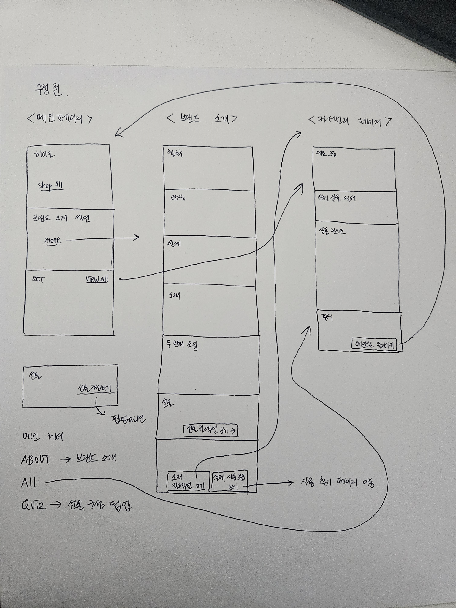
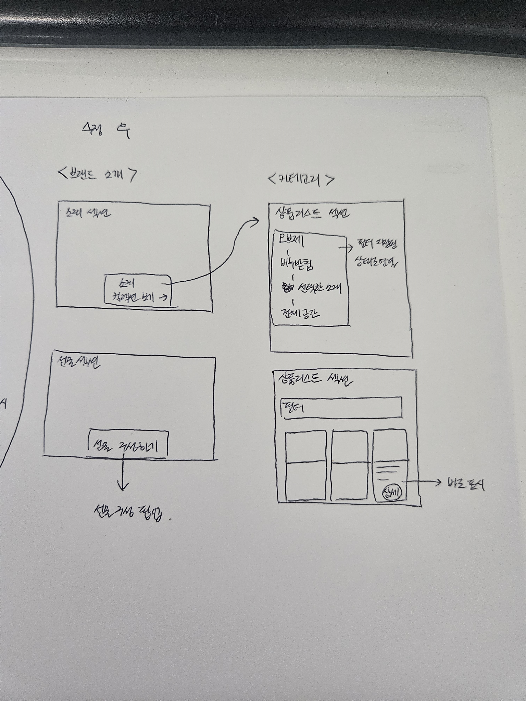
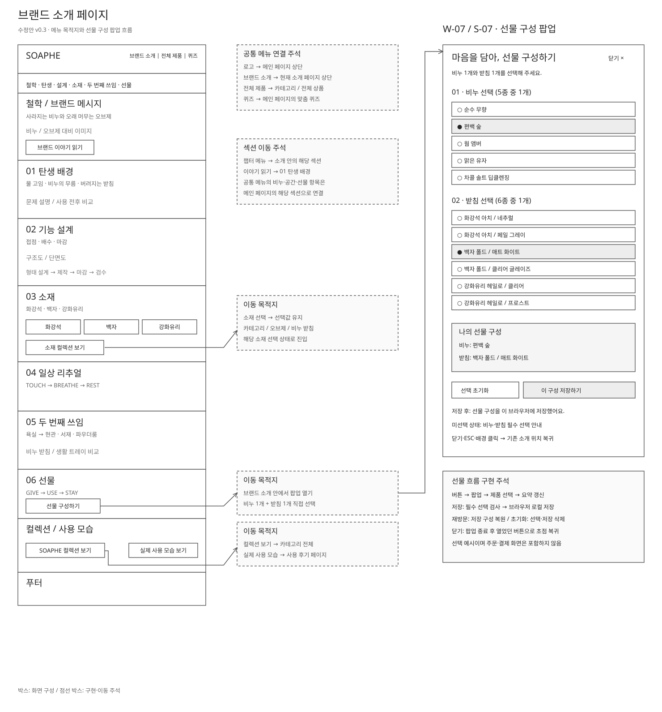
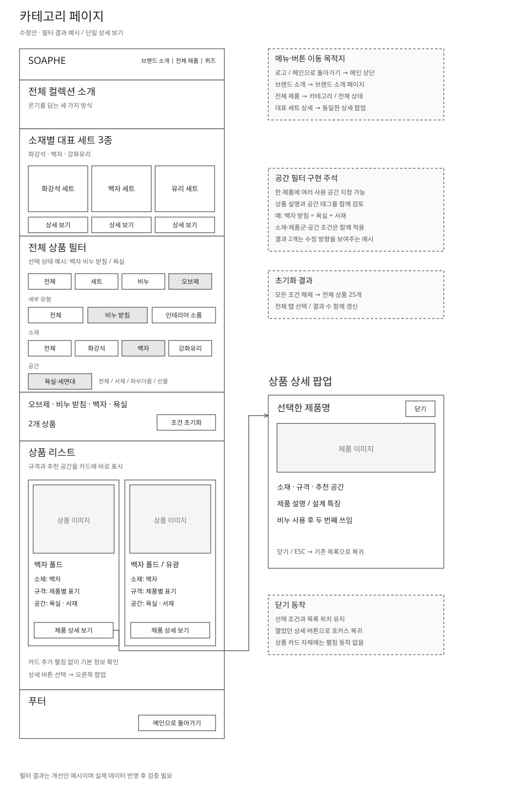
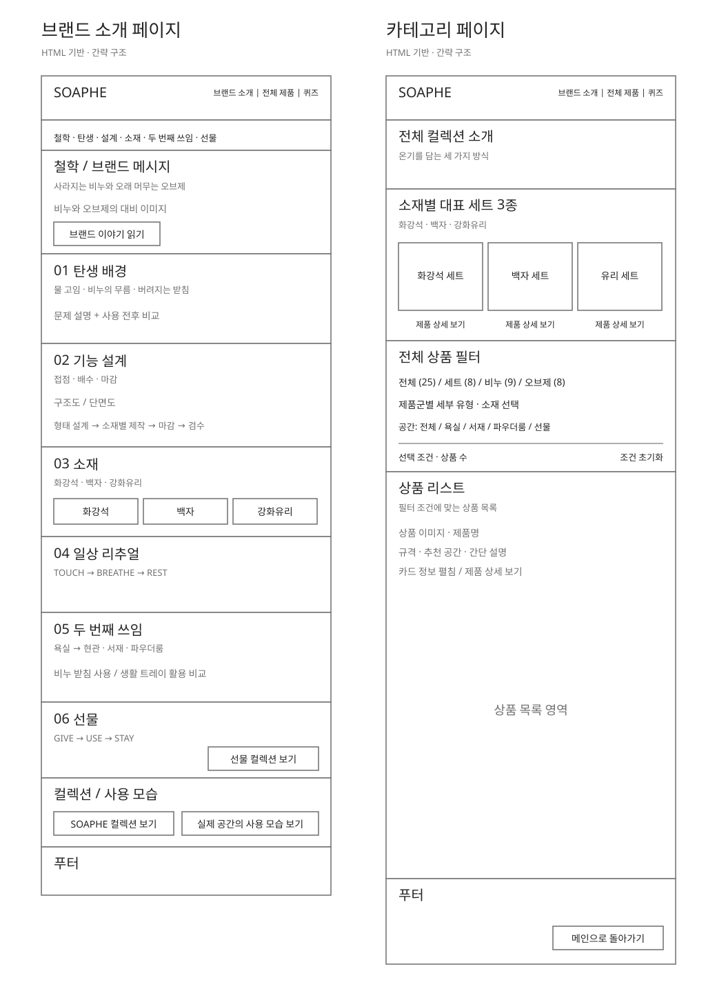

# 프로토타입 기초데이터 수집 및 스케치 제출 보고서

## 1. 제출 정보

| 항목 | 작성 내용 |
|---|---|
| 이름 | 이은경 |
| 평가일 | 2026-10-21 |
| 프로젝트명 | SOAPHE: 사라지는 비누와 오래 머무는 오브제를 연결하는 브랜드 웹사이트 |
| 대상 매체·화면 | 웹사이트: 메인, 브랜드 소개, 카테고리 3개 페이지. PC 우선 설계, 모바일 대응 검토 포함 |
| 보고서 파일명 | 현재 편집 원본: SOAPHE_프로토타입_제출보고서.md v1.7 최종본. 최종 제출 시 PDF로 변환 |
| 편집 원본 파일 또는 공유 링크 | SOAPHE_프로토타입_제출보고서.md / 디자인 원본·프로토타입 링크는 제출 전 입력 |
| 링크 권한 확인 시각 | 미확인. 평가자 접근 권한 확인 후 실제 날짜·시각 기입 |
| 사용 도구 | 제공 원본: HTML·CSS·JavaScript, JPG. 보고서 및 도식 작성: Python·ReportLab. 디자인 편집 도구는 작성자 확인 필요. 모의 점검: AI 시나리오 검토·Node.js 코드 실행. 수정 전후 자료: 편집 가능한 SVG 도형·텍스트 |

## 2. 프로젝트 브리프

### 2.1 배경과 문제

- 프로젝트 배경: SOAPHE는 비누와 받침을 함께 제안하고, 비누를 사용한 뒤에도 받침을 생활 트레이로 활용하는 브랜드이다. 웹사이트에서 향·소재·형태·사용 공간의 관계를 이해하고 제품을 탐색할 수 있도록 구성한다.
- 해결할 사용자 문제: 사진만으로는 제품 간 향·소재·쓰임의 차이를 판단하기 어렵고, 비누 받침을 다른 공간에서 활용하는 가치가 전달되지 않을 수 있다. 이는 현재 기획 가설로, 사용성 점검에서 확인한다.
- 대상 사용자와 사용 맥락: 욕실과 생활 공간을 정돈할 소품 또는 실용적인 선물을 찾는 사용자. 온라인에서 제품 사진과 설명을 비교하며 자신의 공간·취향에 맞는 조합을 탐색한다. 구체적인 연령·성별은 조사 없이 제한하지 않는다.
- 프로젝트 목표: 첫 방문자가 SOAPHE의 핵심 가치를 이해하고, 세트·비누·오브제 및 소재·공간 조건을 활용하여 원하는 제품을 찾도록 돕는다.
- 핵심 과업: 메인에서 브랜드·제품 개요 확인 → 필요하면 브랜드 소개에서 설계·소재·두 번째 쓰임 이해 → 카테고리에서 조건 선택 → 결과와 제품 정보 확인. 메인에서 바로 카테고리로 이동하는 경로도 제공한다.

### 2.2 디자인 기획

| 항목 | 내용 | 이후 연결 위치 |
|---|---|---|
| 핵심 콘셉트 | 사라지는 비누와 오래 머무는 오브제. 사용 중의 감각과 사용 후의 쓰임을 연결한다. | 메인 첫인상, 브랜드 소개 도입·두 번째 쓰임, 카테고리 도입 |
| 디자인 키워드 | 온기, 정갈함, 촉감, 자연 소재, 지속되는 쓰임 | 6번 스케치 비교, 8번 시각 방향 |
| 콘텐츠 우선순위 | 브랜드·상품 정체성 → 대표 조합 → 소재·향 차이 → 공간별 쓰임 → 전체 제품 탐색 | 메인 콘텐츠 위계, 브랜드 소개 챕터, 필터·상품 카드 |
| 대상 매체의 조건 | PC는 비교와 이미지 감상, 모바일은 세로 탐색과 터치 조작을 우선한다. | 7번 시안, 8번 화면·그리드 |
| 제약·전제 | 평가 범위는 3개 페이지. 결제·회원가입·예약 완료는 범위 밖이다. 제품 확인은 카드 또는 간단 정보 패널에서 끝낸다. | 5번 성공 조건, 9번 점검 |

## 3. 기초데이터 수집 계획

### 3.1 필요한 데이터

| ID | 데이터 유형 | 필요한 내용 | 사용 목적 | 우선순위 | 확보 방법 |
|---|---|---|---|---|---|
| D-01 | 현재 화면 | 메인 전체 구성과 주요 이미지 배치 | 시각 방향·콘텐츠 순서 파악 | 높음 | 제공된 메인.jpg 확인 |
| D-02 | 브랜드 콘텐츠 | 탄생 배경, 기능 설계, 소재, 리추얼, 두 번째 쓰임, 선물 | 브랜드 소개의 정보 위계 설정 | 높음 | 제공된 브랜드 소개 HTML의 본문 확인 |
| D-03 | 제품·탐색 데이터 | 세트·비누·오브제 분류, 소재·공간 조건, 상품명·규격·추천 공간 | 카테고리 구조와 상태 정의 | 높음 | 제공된 카테고리 HTML 본문·스크립트 확인 |
| D-04 | 외부 사례 | 브랜드 이야기, 제품 분류, 공간별 탐색의 사례 | 레퍼런스 비교와 적용 판단 | 높음 | FRAMA·BINU BINU·Ferm Living 공식 페이지 확인 |
| D-05 | 제품 근거·원본 자산 | 실제 소재 규격, 제품 수, 향 정보, 이미지·서체 권리, 고해상도 화면 | 문구 신뢰성·최종 시안 품질 확보 | 높음 | 작성자 보유 원본·제품 기획 자료 추가 확보 |
| D-06 | 수정 전후 와이어프레임 | 사용자 손 스케치, HTML 기반 통합 SVG, 수정된 브랜드 소개·카테고리 SVG | 문제와 화면 수정의 대응 근거 | 높음 | 제공 스케치와 생성 SVG의 구성·주석 비교 |

### 3.2 수집 데이터 출처표

| ID | 자료명·내용 | 원출처 URL·서지정보 | 제작자 | 확인일 | 이용 조건·권리 상태 | 실제 사용 위치 |
|---|---|---|---|---|---|---|
| D-01 | 소피 메인 전체 화면 | 사용자 제공 메인.jpg | 원본 제작자 미확인 | 2026-10-21 | 제공 자료로 분석. 개별 이미지·서체 권리는 별도 확인 | 2번 브리프, 6~8번 방향, PDF 증빙 A-01 |
| D-02 | 소피 브랜드 소개 스토리보드 | 사용자 제공 브랜드소개페이지_와이어프레임.html | 원본 제작자 미확인 | 2026-10-21 | 제공 자료로 분석. 성능·제작 설명은 검증 자료와 대조 필요 | 2·5·7번, PDF 증빙 A-02 |
| D-03 | 소피 카테고리 구조·상품 데이터 | 사용자 제공 카테고리 페이지(1).html | 원본 제작자 미확인 | 2026-10-21 | 제공 자료로 분석. 상품 수·규격·가격은 확정 정보인지 확인 필요 | 3·5·7·9번, PDF 증빙 A-03 |
| D-04 | FRAMA, BINU BINU, Ferm Living 공식 웹페이지 | 정확한 URL은 4.1의 R-01~R-03에 기재 | 각 브랜드. 사이트 제작 대행사 미확인 | 2026-10-21 | 공개 열람 자료. 구조·원리 분석에만 사용하며 사진·문구·코드는 재사용하지 않음 | 4번 레퍼런스 분석 |
| D-05 | 제품 사양·고해상도 이미지·권리 자료 | 미확보: 작성자 원본 또는 제품 기획 문서 필요 | 미확인 | 미확보 | 사용권·가공 허용 범위를 개별 확인 | 최종 상품 문구·출처표 보완 예정 |
| D-06 | 손 스케치 및 수정 전후 SVG | 사용자 제공 image(20261021-093108).png(수정 전), image(20261021-093116).png(수정 후) / 수정 전: SOAPHE_브랜드소개_카테고리_간략와이어프레임.svg / 수정 후: 브랜드 소개·카테고리 개별 SVG | 손 스케치: 사용자 / SVG: AI 보조 제작 | 2026-10-21 | 제공 스케치·자체 제작 도형을 분석·편집에 활용. 외부 사진 재사용 없음 | 5·7·9.4·10·11번 |

### 3.3 데이터 정리와 선정

| ID | 형식·규격 | 장점 | 한계·위험 | 사용·가공·제외 결정과 이유 |
|---|---|---|---|---|
| D-01 | JPG, 294 × 2048px | 전체 섹션 흐름·이미지 비중 파악 가능 | 작은 텍스트·정확한 간격·실제 PC 폭을 판독하기 어려움 | 전체 구성 분석에 사용. 판독 불가 문구의 임의 전사는 제외 |
| D-02 | HTML·CSS·JavaScript | 챕터별 설명과 이동 구조 확인 가능 | 이미지 자리표시자 포함. 코드상 설명과 실제 성능은 구분 필요 | 확인된 본문을 브랜드 정보구조의 근거로 사용 |
| D-03 | HTML·CSS·JavaScript | 분류·다단계 필터·결과 없음·모달·키보드 처리 확인 가능 | 브라우저 실행 미수행. 원본 필터·초기화 함수를 최소 DOM 모형에서 실행하여 기본 25종·일부 조건의 결과 수 확인. 확정 사양은 미확인 | 기능 설계·제한적 코드 점검에 사용. 코드 결과와 실제 브라우저·사용자 경험은 구분 |
| D-04 | 공개 웹페이지 | 유사 상품군과 공간 탐색 원리 비교 가능 | 동적 UI·반응형·키보드 상태는 텍스트 열람만으로 검증 불가 | 관찰 가능한 구조만 분석하고 미확인 조작은 추가 점검 대상으로 구분 |
| D-05 | 확보 예정: 사양표·고해상도 이미지·라이선스 | 신뢰성 있는 제품 설명과 시각 작업에 필요 | 미확보 상태에서 효능·수치·이용권 단정 불가 | 확보 후 최종 반영. 확인되지 않은 의학적 효능·잔향 시간 등의 확정 표현 제외 |
| D-06 | PNG·SVG / 수정 전 통합 1040×1450, 수정 후 소개 1480×1590·카테고리 1060×1640 | 화면 구성과 수정 의도를 전후 비교할 수 있음 | 정적 도식이므로 클릭·필터·모달 기능을 실행하지 않음 | 수정 전 자료는 보관하고 개별 수정안을 비교. 설계 반영과 기능 구현을 분리하여 기록 |

## 4. 레퍼런스 비교분석

### 4.1 비교 대상

| ID | 서비스·사례 | 선정 이유 | 원출처·확인일 | 비교할 화면·과업 |
|---|---|---|---|---|
| R-01 | FRAMA | 생활 철학·공간·셀프케어를 연결하고 향·제품 유형을 나눠 탐색함 | https://framacph.com/blogs/landing-pages/landing-page-brand ; https://framacph.com/collections/self-care / 2026-10-21 | 브랜드 소개에서 컬렉션으로 이동, 향·제품 종류로 탐색 |
| R-02 | BINU BINU | 비누·받침·생활 오브제·선물 세트의 상품 구성이 소피와 가까움 | https://www.binu-binu.com/pages/about ; https://www.binu-binu.com/collections/all / 2026-10-21 | 브랜드 이야기의 원료·형태 설명, 제품군 탐색 |
| R-03 | Ferm Living | 공간을 기준으로 여러 제품군을 함께 제안함 | https://fermliving.com/collections/the-bathroom / 2026-10-21 | 욕실에 어울리는 제품을 공간 단위로 찾는 과정 |

### 4.2 공통 기준 비교

| 비교 기준 | R-01 | R-02 | R-03 | 우리 프로젝트의 판단 |
|---|---|---|---|---|
| 정보구조·레이블 | 제품군·향·사용 공간을 구분 | Soap·Soap Dishes·Objects·Gift Sets 구분 | Bathroom 등 공간으로 상품 구성 | 1차 제품군, 필요 시 세부 유형·소재, 별도 공간 조건으로 구분 |
| 내비게이션·이동성 | 소개에서 관련 제품·전체 컬렉션 연결 | About와 Shop의 제품군 연결 | 공간별 컬렉션에서 제품 탐색 | 메인에서 브랜드 소개·카테고리로 직접 이동. 소개 하단에는 컬렉션 연결 |
| 인터페이스·조작 | 향 선택, 제품 유형 선택, Clear all 제공 | 제품별 가격·구매 관련 조작 표시 | 정렬과 Add to Cart·Notify me 표시 | 필터와 상세 확인을 명확히 구분. 구매 조작은 평가 범위에서 제외 |
| 콘텐츠 위계 | 철학 소개와 대표 제품 연결 | Story·Inspiration·Ingredients·Form 구분 | 공간 제목과 상품 목록 중심 | 브랜드 소개는 이유·설계·소재·쓰임, 카테고리는 조건·결과·상품 정보 순서 |
| 비주얼·그래픽 | 공간과 제품을 하나의 생활 이미지로 연결 | 비누의 형태와 욕실 건축·소재의 관계 설명 | 다양한 생활 소품을 공간 맥락으로 제시 | 메인은 공간 이미지, 소재 섹션은 질감, 목록은 제품 비교를 우선 |
| 피드백·상태 | 결과 개수·초기화 항목 확인. 실제 갱신 미검증 | 가격·추가 관련 표시 확인. 상태 전환 미검증 | 구매 가능·입고 알림 표시 확인. 전환 미검증 | 선택 표시·결과 수·초기화·결과 없음·상세 닫기 상태를 직접 설계 |

### 4.3 적용 결정

| 원리·패턴 | 적용 | 변형 | 제외 | 결정 이유 | 적용할 화면 |
|---|:---:|:---:|:---:|---|---|
| 브랜드 철학에서 관련 컬렉션으로 연결 | O | - | - | 읽은 정보가 실제 제품 탐색으로 이어져야 함 | 메인·브랜드 소개 |
| 비누·받침·선물의 제품군 구분 | - | O | - | 소피의 세트·비누·오브제 구조로 명칭과 범위를 조정 | 카테고리 |
| 공간 기준 탐색 | - | O | - | 별도 대규모 공간관 대신 욕실·서재·파우더룸 등의 조건으로 제공 | 카테고리 |
| 전체 상품을 한 단계에 노출하는 대형 메뉴 | - | - | O | 소피 3개 페이지의 평가 범위와 상품 규모에 비해 복잡함 | 공통 메뉴 |
| 타 브랜드 사진·문구·코드 그대로 복제 | - | - | O | 브랜드 차별성과 권리 문제를 고려하여 원리만 참고 | 전체 |

## 5. 핵심 과업과 스토리보드

### 5.1 과업 정의

| 항목 | 내용 |
|---|---|
| 수행자 역할 | SOAPHE를 처음 방문한 잠재 고객 |
| 시작 상황 | 욕실 또는 생활 공간에 어울리는 비누·트레이 조합을 찾으며 메인에 진입 |
| 달성할 목표 | 브랜드 특징을 이해하고 자신의 공간과 취향에 맞는 제품 후보 1개 확인 |
| 성공 조건 | 브랜드 특징을 자신의 말로 설명하고, 조건을 선택해 제품명·소재·추천 공간을 확인. 결과가 없으면 조건 초기화로 회복 |
| 예상 제약·오류 | 세트와 단품 혼동, 단계별 필터 혼동, 카드 클릭과 상세 버튼의 역할 혼동, 결과 없음, 긴 소개 중 이동 버튼을 놓침 |

### 5.2 화면 흐름 요약

메인(S-01) → 브랜드 소개(S-02, 선택 경로) → 카테고리 기본(S-03) → 조건 선택·결과(S-04) → 제품 정보 확인(S-05) → 목록 복귀(S-04).

빠른 탐색: 메인(S-01) → 카테고리(S-03).

수정 후 진입 조건: 브랜드 소개의 소재 컬렉션 보기 → 카테고리 / 오브제 / 비누 받침 / 선택 소재. 선물 구성하기 → 브랜드 소개 안의 선물 구성 팝업 / 비누 1개·받침 1개 선택 / 구성 저장. SOAPHE 컬렉션 보기 → 카테고리 / 전체 상품. 실제 사용 모습 보기 → 사용 후기 페이지(연결 목적지만 표기, 상세 설계는 평가 범위 밖).

오류 회복: 결과 없음(S-06) → 조건 초기화 → 카테고리 기본(S-03).

### 5.3 스토리보드

| 화면 ID | 화면 목적 | 주요 콘텐츠·요소 | 사용자 행동 | 시스템 결과·피드백 | 다음 화면·분기 | 모션·시간 표현 |
|---|---|---|---|---|---|---|
| S-01 | 브랜드 인지와 탐색 진입 | 공간 메인 이미지, 브랜드 요약, 대표 세트, 소재, 비누, 공간·후기 | 스크롤, 브랜드 소개 또는 전체 제품 선택 | 링크 위치와 이동 목적 표시 | S-02 또는 S-03 | 링크 호버 150ms 제안. 과도한 진입 애니메이션 제외 |
| S-02 | 제품을 만드는 이유 이해 | 탄생·기능 설계·소재·리추얼·두 번째 쓰임·선물 | 챕터 탐색, 소재·전체 컬렉션 선택 또는 선물 구성하기 선택 | HTML에 목적지·소재 조건 전달 및 선물 구성 팝업 반영 | S-03, 조건이 적용된 S-04 또는 S-07 | 앵커 스크롤 250ms 제안. 모션 감소 설정 시 즉시 이동 |
| S-03 | 전체 제품 구조 파악 | 소재 대표 세트, 제품군 탭, 공간 조건, 전체 상품 수 | 세트·비누·오브제 선택 | 선택 탭, 하위 옵션, 결과 개수 갱신 | S-04 또는 S-06 | 필터 피드백은 즉시 표시 |
| S-04 | 조건에 맞는 상품 비교 | 선택 조건, 적용 결과 수, 제품명·소재·규격·추천 공간 | 소재·공간 선택, 상세 버튼 선택 | 일치 상품 표시. 클릭 가능한 영역 구분 | S-05 또는 S-06 | 선택 강조 150ms 제안 |
| S-05 | 제품 후보 확인 | 제품명, 소재·규격, 추천 공간, 형태와 두 번째 쓰임 | 내용 확인, 닫기·ESC | 정보 패널 닫힘, 열었던 버튼으로 포커스 복귀 | S-04 | 패널 진입 200ms 제안. 감소 설정 시 즉시 표시 |
| S-06 | 결과 없음에서 회복 | 일치 상품 없음, 조건 변경 안내, 모든 조건 초기화 | 초기화 또는 조건 변경 | 전체 조건 해제 또는 새로운 결과 표시 | S-03 또는 S-04 | 회복 결과 즉시 표시 |
| S-07 | 나만의 선물 세트 구성 | 비누 5종·받침 6종, 구성 요약·초기화·저장·닫기 | 각 제품군에서 1개씩 선택하고 저장 | 필수 선택 검사 후 브라우저 localStorage 저장, 저장 메시지 표시 | 같은 팝업 또는 S-02 | 네이티브 dialog. 브라우저 조작 미검증 |

스토리보드 증빙: 사용자가 제공한 수정 전·후 화면 흐름 손 스케치. 수정 전에는 전체 페이지 연결을, 수정 후에는 소재 조건 진입·선물 구성 팝업·카드 상세 확인을 구체화했다. 선물 팝업의 세부 상태는 브랜드 SVG v0.3으로 보완한다.

| 수정 전 화면 흐름 | 수정 후 화면 흐름 |
|---|---|
|  |  |

## 6. 아이디어 발상과 썸네일 스케치

### 6.1 발상 과정

- 사용한 발상 방법: 사용자의 질문을 기준으로 콘텐츠 묶음을 만들고, 동일 콘텐츠의 배치·우선순위를 바꾸는 형태적 조합법을 사용했다. 아래 대안은 이번 보고서에서 새로 만든 설계 제안이다.
- 도출한 핵심 단어·아이디어: 공간의 온기, 향과 소재, 사라짐과 남음, 비누에서 생활 트레이로, 빠른 비교, 조건별 탐색.
- 스케치에서 확인할 질문: 메인에서 어떤 브랜드인지 바로 이해되는가? 소개를 읽은 뒤 제품 탐색으로 이어지는가? 필터를 제품군·소재·공간으로 구분할 수 있는가?

### 6.2 화면별 대안

| 스케치 ID | 대응 화면 | 대안의 핵심 차이 | 장점 | 한계 |
|---|---|---|---|---|
| T-S01-A | 메인 S-01 | 공간 대형 이미지 → 브랜드 요약 → 대표 제품 → 소재·쓰임 | 기존 메인의 공간 중심 인상을 이어감 | 구매 목적 방문자는 제품 목록까지 내려가야 함 |
| T-S01-B | 메인 S-01 | 첫 화면을 브랜드 설명·제품 사진의 좌우 분할로 구성 | 브랜드와 제품 정체성을 동시에 전달 | 공간의 몰입감은 A보다 약함 |
| T-S01-C | 메인 S-01 | 세트·비누·오브제 진입을 상단에 우선 배치 | 목적이 명확한 사용자의 탐색이 빠름 | 소피 고유의 철학이 약하게 전달될 수 있음 |
| T-S02-A | 소개 S-02 | 번호가 있는 세로 챕터와 이미지·설명 교차 배치 | 탄생에서 두 번째 쓰임까지 인과관계 명확 | 페이지 길이가 길어짐 |
| T-S02-B | 소개 S-02 | 사라지는 비누·남는 오브제의 두 축으로 대비 | 핵심 콘셉트가 빠르게 이해됨 | 좁은 화면에서 대비 구조 재배치 필요 |
| T-S02-C | 소개 S-02 | 기능·소재·리추얼·선물을 카드로 요약 | 필요한 주제를 빠르게 선택 가능 | 이야기의 흐름이 분절될 수 있음 |
| T-S03-A | 카테고리 S-03 | 상단 소재 대표 세트 3개 + 가로 필터 + 목록 | 대표 조합과 전체 상품 비교를 함께 지원 | 상단 콘텐츠가 길면 목록 진입 지연 |
| T-S03-B | 카테고리 S-03 | 왼쪽 필터 + 오른쪽 상품 목록 | 필터를 유지하며 비교 가능 | 25종 규모에는 제어 영역이 과할 수 있음 |
| T-S03-C | 카테고리 S-03 | 공간별 진입 카드 → 해당 공간 추천 목록 | 제품 지식이 부족해도 탐색 가능 | 전체 제품을 비교하려면 이동이 늘어남 |

썸네일 스케치 증빙: [기존 PDF 부록 C-01~C-03](SOAPHE_프로토타입_제출보고서.pdf)에 비교용 대안 9개 수록. 원래 작업 이력이 아닌 AI 보조 설계 제안이다.

### 6.3 대안 비교와 선정

| 비교 기준 | 대안 A | 대안 B | 대안 C | 선택·조합 결과 |
|---|---|---|---|---|
| 사용자 목표 지원 | 브랜드 이해와 상품 탐색을 함께 지원 | 설명·비교에는 유리, 화면 제어가 늘어남 | 빠른 탐색 또는 특정 공간 탐색에 유리 | A를 기본으로 직접 카테고리 진입 링크 보강 |
| 정보 위계 | 순차적 위계가 명확 | 동시에 비교할 정보가 많음 | 선택지는 명확하나 이야기 연결이 약함 | 소개 A의 순서와 B의 콘셉트 대비를 조합 |
| 조작 명확성 | 상단 메뉴·가로 필터로 조작 부담이 낮음 | 필터가 많아지면 관리 부담 발생 | 공간 선택과 제품군 선택을 혼동할 수 있음 | 카테고리 A에 선택 조건·초기화 명시 |
| 흐름 연결 | 메인 → 소개 → 제품의 연결에 적합 | 각 영역 이동 규칙을 추가로 설명해야 함 | 공간 안에서 탐색이 제한될 수 있음 | A의 기본 흐름과 메인 직접 탐색 경로 병행 |
| 구현 가능성 | 기존 HTML 구조와 가까움 | 모바일 분할·고정 패널 재설계 필요 | 공간별 목록·추천 데이터 추가 필요 | 기존 자료를 활용할 수 있는 A 우선 |

- 최종 방향과 이유: 세 페이지 모두 A를 기본 구조로 선택했다. 메인은 공간 이미지와 제품 진입을 함께 제공하고, 소개는 세로 챕터 사이에 비누·오브제 대비를 넣는다. 카테고리는 대표 소재 세트를 짧게 소개한 뒤 제품군·소재·공간 조건과 결과를 명확히 분리한다. 현재 원본을 전면 교체하기보다 이해와 탐색을 보완하는 방향이다. 이후 수정 후 SVG에서 이동 목적지·필터 선택 상태·단일 상세 팝업을 구체화했다. 이 변경은 A·B·C의 새로운 대안이 아니라 선정한 안의 보완이다.

## 7. 저충실도 세부 시안

### 7.1 화면·상태 목록

| 시안 ID | 대응 스토리보드 | 화면·상태 | 사용 데이터 | 주요 기능 | 다음 연결 |
|---|---|---|---|---|---|
| W-01 | S-01 | 메인 / 이번 수정 범위 밖 | D-01·06 | 브랜드·제품 개요, 소개·카테고리 진입 | W-02 또는 W-03 |
| W-02 v0.3 | S-02 | 브랜드 소개 / 목적지 주석 반영 | D-02·06 | 챕터 이동, 소재·전체 컬렉션 진입 및 선물 구성 팝업 | W-03·W-04 또는 W-07 |
| W-03 | S-03 | 카테고리 전체 / 기본 상태 | D-03·06 | 전체 25개, 제품군·세부 유형·소재·공간 탐색 | W-04 |
| W-04 v0.2 | S-04 | 오브제·비누 받침·백자·욕실 선택 상태 | D-03·06 | 선택 조건·결과 수·초기화와 상품 2개 예시 | W-05 또는 W-03 |
| W-05 v0.2 | S-05 | 단일 제품 상세 팝업 | D-03·06 | 상세 버튼으로 열기, 닫기·ESC로 목록 복귀 | 선택 조건·위치를 유지한 W-04 |
| W-06 | S-06 | 결과 없음 / 기존 설계 유지 | D-03 | 결과 없음 안내·모든 조건 초기화 | W-03 |
| W-07 v0.3 | S-07 | 선물 구성 팝업 / 편백·백자 선택 예시 | D-02·03·06 | 비누 5종·받침 6종에서 각 1개 선택, 요약·초기화·저장·닫기 | W-02 또는 팝업 유지 |

### 7.2 구현 주석

| 시안 ID·요소 | 콘텐츠·기능 | 입력·행동 | 상태·피드백 | 구현 제약·미결정 |
|---|---|---|---|---|
| W-02·공통 헤더 | 로고·브랜드 소개·전체 제품·퀴즈의 도착 위치 | 메뉴 선택 | 로고는 메인 상단, 전체 제품은 카테고리 전체, 퀴즈는 메인 맞춤 퀴즈 구간 | 목적지 주석 반영. 실제 메인 URL·섹션 ID 확인 필요 |
| W-02·챕터 메뉴 | 철학·탄생·설계·소재·두 번째 쓰임·선물 | 챕터 또는 이야기 읽기 선택 | 같은 소개 페이지의 해당 섹션으로 이동 | 고정 헤더에 제목이 가리지 않도록 구현 시 확인 |
| W-02·소재 컬렉션 | 선택 소재와 관련된 비누 받침 탐색 | 소재 선택 후 컬렉션 보기 | 카테고리 / 오브제 / 비누 받침 / 선택 소재로 진입 | HTML에 URL 조건 전달·읽기 구현 완료. 실제 클릭 이동 미검증 |
| W-02·선물·전체·사용 모습 | 버튼마다 다른 도착 목적 구분 | 버튼 선택 | 선물은 구성 팝업, 전체 컬렉션은 전체 탭, 사용 모습은 사용 후기 페이지 | HTML 반영 완료. 메인·후기 대상 파일과 실제 실행 점검 필요 |
| W-04·다단계 필터 | 제품군 → 세부 유형 → 소재, 별도 공간 조건 | 오브제·비누 받침·백자·욕실 선택 | 선택 항목을 회색 배경으로 표시하고 조건·결과 수를 함께 제시 | spaceTags 배열과 includes 조건으로 구현 완료. 백자·욕실 2개 코드 확인 |
| W-04·상품 카드 | 이미지·제품명·소재·규격·추천 공간 상시 노출 | 기본 정보를 읽고 제품 상세 보기 선택 | 카드 펼침 단계를 거치지 않고 상세 팝업으로 이동 | 카드 펼침 제거, 기본 정보 상시 노출과 상세 버튼 구현 완료 |
| W-05·상세 팝업 | 제품 설명·설계 특징·두 번째 쓰임 | 상세 버튼·닫기·ESC | 같은 목록·선택 조건·스크롤 위치로 복귀, 열었던 버튼으로 포커스 복귀 | HTML에 모달·ESC·포커스 복귀 구현. 브라우저 동작 미검증 |
| W-04·초기화 | 전체 목록으로 회복 | 조건 초기화 선택 | 모든 조건 해제, 전체 탭·전체 25개 상태로 복귀 | 수정 함수에서 전체 25개 회복 확인. 브라우저 조작은 후속 검증 |
| W-06·결과 없음 | 일치 상품 없음과 회복 안내 | 모든 조건 초기화 | W-03으로 복귀 | 별도 신규 SVG 상태는 만들지 않았으며 기존 설계 유지 |

| W-07·선물 구성 팝업 | 비누 5종·받침 6종에서 각 1개 선택 | 선택·초기화·저장·닫기 | 구성 요약 갱신, 필수 선택 검사, 로컬 저장·복원 | HTML 및 브랜드 SVG v0.3 반영 완료. 구매·결제 연결 없음, 브라우저 미검증 |

## 8. 전달 매체와 시각·모션 방향

| 항목 | 결정 | 적용 화면 | 선택 근거 |
|---|---|---|---|
| 화면 크기·방향 | 제안 기준: PC 1440px, 모바일 390px 세로. 820px 부근 전환을 검토 | 전체 | 제공 HTML의 모바일 구간과 연결. 메인 JPG의 294px은 원본 설계 폭으로 보지 않음 |
| 그리드·여백 | 제안: PC 최대 콘텐츠 폭 1280px, 상품 3열, 모바일 2열에서 가독성 점검. 긴 설명은 1열 전환 | 전체·카테고리 | HTML의 1280px 컨테이너를 참고하며 사진 비교·문장 길이 균형 확보 |
| 타이포그래피 | 한글은 읽기 쉬운 산세리프, 영문 제목은 세리프 포인트. 본문 16px·보조 14px을 시안 기준으로 제안 | 전체 | 제공 HTML의 Pretendard·Newsreader 선언 참고. 폰트 로드와 라이선스는 배포 전 확인 |
| 컬러 | 메인 이미지의 아이보리·브라운 중심, 제품·소재 사진의 색을 보조로 활용. 정확한 HEX는 웹용 가이드 확정 후 입력 | 전체 | 따뜻한 공간 이미지와 소재의 질감을 연결. 앱에서 쓰던 색을 웹 확정값으로 전용하지 않음 |
| 이미지·텍스처 | 메인은 공간, 소재는 근접 질감, 목록은 동일 배경·비율의 제품 컷, 두 번째 쓰임은 전후 공간 비교 | 페이지·섹션별 | 사용 맥락과 비교 목적을 사진 종류로 구분 |
| 아이콘·그래픽 | 필터·초기화·닫기는 단순한 선형 아이콘과 텍스트를 병기. 설계는 구조도 활용 | 카테고리·브랜드 소개 | 의미를 사진·이모지만으로 전달하지 않음 |

### 필요한 모션

| 모션 ID | 발생 조건 | 대상·변화 | 목적 | 예상 시간 | 모션을 볼 수 없을 때의 대체 표현 |
|---|---|---|---|---|---|
| M-01 | 필터·탭 선택 | 선택 배경·테두리 변경 | 현재 조건 인지 | 150ms | 선택 테두리·텍스트·aria-selected 유지 |
| M-02 | 챕터 선택 | 해당 섹션으로 스크롤 | 긴 소개 안의 위치 이동 | 250ms | 감소 설정 시 즉시 이동·제목 포커스 |
| M-03 | 상세 패널 열기·닫기 | 패널·배경의 짧은 전환 | 목록과 상세 정보의 관계 표시 | 200ms | 즉시 표시·닫기, 포커스 이동·복귀 |

## 9. 사용성 점검

### 9.1 점검 계획

| 항목 | 내용 |
|---|---|
| 점검 목적 | 세 가지 이용 목적을 가진 가상 참여자의 과업 경로를 검토하고, 원본 코드에서 확인되는 탐색 장애·회복 방식을 찾는다. |
| 수행자 역할·번호 | 모두 AI가 설정한 가상 참여자이다. 9.2는 실제 사용자 관찰이 아닌 수정 전 모의 점검이며 시간 미측정이다. P-01: 브랜드를 처음 접하고 욕실용 세트를 찾는 사용자. P-02: 소재를 비교하여 백자 비누 받침을 찾는 사용자. P-03: 조건을 바꾸며 선물 후보를 찾는 사용자. 실제 사람·모집 인원·실제 발언은 없다. |
| 사용한 결과물 버전 | 제공본 메인.jpg·브랜드소개페이지_와이어프레임.html·카테고리 페이지(1).html. 점검일 2026-10-21. 이 표와 9.2는 수정 전 원본 기준으로 보존하며, 최신 HTML 반영·재확인은 10번에서 기록. |
| 핵심 과업 | P-01: 브랜드 가치 이해 후 욕실용 세트 찾기. P-02: 백자 비누 받침 찾기와 욕실 조건 추가. P-03: 일치 결과가 없는 조건에서 전체 목록으로 회복. |
| 성공 조건 | 과업에 해당하는 정보·제품 후보·회복 경로가 자료와 코드에 존재하는지 확인한다. 사람의 이해도·탐색 성공률로 해석하지 않는다. |
| 진행 방식 | AI가 역할별 탐색 경로를 구성했다. 메인은 정적 이미지, 소개는 본문·링크를 검토했다. 카테고리에서는 원본 renderArchiveGrid·updateFilterStatus·resetAllFilters 함수를 최소 DOM 모형으로 실행했다. 브라우저 화면·터치·키보드 이벤트는 실행하지 않았다. |
| 질문·관찰 항목 | 브랜드 메시지가 관련 제품으로 이어지는가? 제품 설명과 공간 필터가 일치하는가? 조건 추가 시 결과가 어떻게 달라지는가? 결과 없음에서 초기화하면 전체 상태가 복구되는가? |

### 9.2 관찰 원자료

| 단계·시간 | 수행자 행동·발언 | 관찰 사실 | 도움 제공 여부 | 결과 |
|---|---|---|---|---|
| P-01 / 단계 1 / 시간 미측정 | 가상 행동: 메인에서 브랜드를 살펴보고 소개로 이동하는 경로를 설정. 실제 발언 없음. | 메인은 JPG이므로 클릭 이동 검증 불가. 소개 본문에는 ‘사라지는 비누와 오래 머무는 오브제’와 두 번째 쓰임 설명이 존재. | 사람 대상 안내·도움 없음 | 메시지·콘텐츠 존재 확인. 이해도·실제 이동은 미검증. |
| P-01 / 단계 2 / 시간 미측정 | 가상 행동: 소개에서 전체 제품으로 이동 후 세트·욕실 조건 선택. | 소개의 전체 제품 링크는 제공된 카테고리 파일과 일치. 해당 필터 상태에서 원본 함수 실행 결과 세트 3개 조회. | 자동화 코드로 조건 주입. 사람 조작 아님 | 조건별 후보 존재 확인. 직접 클릭·패널 열기는 미검증. |
| P-01 / 단계 3 / 시간 미측정 | 가상 행동: 소개 상단 ‘비누 소개’ 메뉴로 이동 시도하는 경로를 검토. | 링크 #scents가 있으나 소개 HTML에 해당 ID 없음. 카테고리도 일부 상단 앵커의 대상 ID가 없음. | 해당 없음 | 제공 HTML 기준 링크 대상 누락 확인. 실제 배포본과 동일한지는 미확인. |
| P-02 / 단계 1 / 시간 미측정 | 가상 행동: 오브제 → 비누 받침용 → 백자 도자기 순서로 선택. | 조건을 원본 함수에 적용하면 ‘백자 도자기 폴드 오브제’와 ‘클리어 글레이즈’ 2개 조회. 상태 문구도 2개로 갱신. | 자동화 코드로 조건 주입 | 해당 조건의 데이터·필터 결과 확인. |
| P-02 / 단계 2 / 시간 미측정 | 가상 행동: 앞선 조건에 욕실·세면대를 추가. | 원본 함수 실행 결과 0개. 두 백자 받침 모두 spaceTag가 desk임. 클리어 글레이즈의 spaceLabel은 ‘홈카페 & 세면대’이지만 욕실 조건에서 제외됨. | 자동화 코드로 조건 주입 | 설명과 공간 태그의 불일치 확인. 예상 어려움: 제품이 없는 것으로 오해할 가능성. |
| P-02 / 단계 3 / 시간 미측정 | 가상 행동: 제품 카드에서 규격과 상세 정보를 확인하는 경로 검토. | 코드상 이미지·헤더 클릭은 카드 펼침, 내부 상세 버튼은 모달 열기로 구성됨. | 해당 없음 | 두 단계 조작 구조 확인. 혼동 여부는 예측이며 실제 관찰 아님. |
| P-03 / 단계 1 / 시간 미측정 | 가상 행동: 백자 비누 받침 조건에 선물·여행을 추가. | 원본 함수 실행 결과 0개이며 ‘선택한 조건에 일치하는 상품이 없습니다’와 전체 초기화 버튼 마크업 생성. | 자동화 코드로 조건 주입 | 결과 없음 안내의 생성 로직 확인. 실제 시각 표시 미검증. |
| P-03 / 단계 2 / 시간 미측정 | 가상 행동: 모든 조건 초기화로 전체 목록 복귀. | 원본 resetAllFilters 함수 실행 후 제품군·세부 유형·소재·공간 값이 모두 all. 전체 25개로 복구되고 결과 수 문구도 전체 25개로 갱신. | 자동화 코드로 함수 호출 | 데이터·상태 회복 확인. 실제 버튼 이벤트·포커스는 미검증. |

### 9.3 프로젝트의 사용성 기준

- 효과성: 과업에 맞는 정보와 후보가 존재하는지, 필터 조건·상품 설명이 일치하는지 확인한다. 모의 점검 결과로 실제 사용자의 이해도나 성공률을 산출하지 않는다.
- 효율성: 설계상 선택 단계와 중복 조작을 검토한다. 실제 사람의 탐색 시간·실수 횟수는 미측정이며 다음 실제 사용자 점검에서 수집한다.
- 이해·학습 용이성: 제품군·세부 유형·소재·공간의 관계와 카드 펼침·모달의 역할을 AI 관점에서 검토한다. 예상 혼동과 코드로 확인한 사실을 구분한다.
- 만족 또는 신뢰: 상품 설명과 공간 조건의 불일치는 신뢰를 해칠 수 있는 설계 위험으로 기록한다. 실제 만족도·참여자 발언은 수집하지 않았다.

### 9.4 문제 도출

| 문제 ID | 관찰 근거 | 문제 진술 | 영향 화면·과업 | 원인 가설 | 우선순위 |
|---|---|---|---|---|---|
| U-01 | P-01 단계 3: 소개 #scents 등 상단 링크의 대상 ID 없음 | 제공된 소개·카테고리 HTML의 일부 공통 메뉴가 존재하지 않는 현재 페이지 앵커를 참조함 | 브랜드·제품 정보 이동 | 메인용 공통 헤더 링크를 다른 페이지에서 그대로 사용한 것으로 추정 | 높음·자료 확인 |
| U-02 | P-02 단계 2: 백자 받침 2개 → 욕실 추가 0개. 세면대 설명 제품의 spaceTag는 desk | 상품 설명의 사용 공간과 실제 필터 포함 범위가 일치하지 않음 | 카테고리 소재·공간 탐색 | 하나의 spaceTag로 여러 사용 공간을 표현하고 완전 일치로 필터링함 | 높음·코드 결과 확인 |
| U-03 | P-02 단계 3: 이미지·헤더 펼침 뒤 내부 상세 버튼이 별도 모달로 연결 | 상세 확인 단계가 겹쳐 조작 목적을 혼동할 가능성 | 카드·모달 탐색 | 요약 펼침과 상세 열기의 역할 구분이 충분하지 않을 수 있음 | 중간·AI 예상 위험 |
| U-04 | 메인 JPG 294px, 메인 HTML 미제공, 브라우저 UI 미실행 | 메인에서 시작하는 전체 흐름·작은 글자·실제 클릭 조작 검증이 제한됨 | 메인·전체 과업 검증 | 실행 가능한 메인 원본과 고해상도 화면 부족 | 높음·검증 한계 |

## 10. 수정과 재확인

| 문제 ID | 수정 전 | 수정 내용 | 수정 이유 | 수정 후 | 반영·보류 | 재확인 결과 |
|---|---|---|---|---|---|---|
| U-01 | 현재 페이지에 없는 공통 메뉴 앵커, 소재와 상품의 직접 연결 부족 | 메인 섹션 경로 지정, 소재별 컬렉션 버튼과 URL 조건 전달·읽기 추가 | 목적지와 소재 조건을 유지해 탐색 단계 축소 | 소재 버튼 → 오브제·비누 받침·선택 소재 목록 | HTML·SVG 반영 | 경로·조건 처리 코드 확인. 메인 원본 미제공으로 대상 ID·브라우저 클릭 미검증 |
| U-02 | 백자 받침 2개에 욕실 조건을 더하면 0개 | spaceTags 배열·includes 필터로 복수 공간 지정, 조건·결과 수·초기화 표시 | 상품 설명과 공간 필터 불일치 보완 | 백자·욕실 2개. 전체 초기화 25개 | HTML·상품 데이터·SVG 반영 | 최소 DOM 코드 실행: 백자 2개, 백자·욕실 2개, 백자·선물 0개, 초기화 25개. 브라우저 미검증 |
| U-03 | 카드 펼침 후 별도 상세 버튼을 누르는 중복 구조 | 카드 기본 정보 상시 노출, 상세 버튼 1개와 단일 팝업 연결 | 비교 정보를 바로 읽고 상세 조작을 명확히 함 | 상세 팝업 → 닫기·ESC·배경 클릭 → 목록·스크롤·초점 복귀 | HTML·SVG 반영 | 이벤트·복귀 코드 및 스크립트 구문 확인. 브라우저·사용자 효과 미검증 |
| U-04 | 저해상도 메인 JPG, 메인 HTML 미확보 | 화면 수정 대상에서 분리하고 자료 확보·검증으로 관리 | 자료 부족을 해결 완료로 기록하지 않기 위함 | 기존 한계 유지 | 보류 | 고해상도 메인·실행 원본 필요 |
| C-01 (사용자 요청) | 선물 컬렉션 보기 → 카테고리 세트 탭 | 선물 구성하기 → 비누 5종·받침 6종에서 각 1개 선택하는 팝업 추가 | 선물 제품을 직접 조합하도록 요청 반영 | 구성 요약·필수 선택 검사·초기화·브라우저 로컬 저장·복원·닫기 | HTML·브랜드 SVG v0.3 반영 | SVG 도형·텍스트·연결 확인 및 스크립트 구문 확인. 주문·결제는 범위 밖, 실제 저장·클릭 미검증 |

사용자 지정 HTML 비교 기준: 브랜드 소개 수정 전 `브랜드소개페이지_와이어프레임.html` / 수정 후 `SOAPHE_brand (1)(1).html`; 카테고리 수정 전 `카테고리 페이지(1).html` / 수정 후 `SOAPHE_category(1).html`. 기존 수정본과 첨부 수정본의 파일 내용이 동일한 것을 확인했다. 아래 증빙은 손 스케치·SVG이며 HTML 브라우저 캡처는 아니다.

| 화면 흐름 증빙 | 수정 전 | 수정 후 |
|---|---|---|
| S-01~07 화면 연결 |  |  |

같은 화면 번호 기준의 수정 전후 스케치:

| 화면 번호 | 수정 전 | 수정 후 |
|---|---|---|
| S-02 / W-02·W-07 브랜드 소개·선물 |  |  |
| S-03·04·05 / W-03·04·05 카테고리 |  |  |

## 11. 최종 종합 패키지

### 11.1 대응표

| 브리프 요구 | 데이터·레퍼런스 | 스토리보드 | 썸네일 | 최종 시안 | 사용성 수정 |
|---|---|---|---|---|---|
| 브랜드 이해 후 관련 제품 탐색 | D-01·02·06, R-01·02 | S-01·02·04 | T-S01-A·T-S02-A | W-02·04 | U-01 목적지·소재 조건 전달 |
| 소재·공간별 비교 | D-03·06, R-01·03 | S-03·04 | T-S03-A | W-03·04 | U-02 복수 공간·백자 욕실 2개 코드 확인 |
| 상세 확인과 복귀 | D-03·06, R-02 | S-05 | T-S03-A | W-05 | U-03 단일 상세 팝업 |
| 결과 없음에서 회복 | D-03, R-01 | S-06 | T-S03-A | W-06 | 초기화 후 전체 25개 코드 확인 |
| 직접 선물 구성 | D-02·03·06, R-02 | S-07 | T-S02-A 보완 | W-07 v0.3 | C-01 사용자 요청에 따른 팝업 추가 |

### 11.2 파일 구조와 버전

| 파일·페이지·프레임 | 내용 | 버전·수정일 | 비고 |
|---|---|---|---|
| SOAPHE_프로토타입_제출보고서.md | 첨부 양식에 맞춘 보고서 | v1.7 최종본 / 2026-10-21 | 제목·표 열·증빙·체크리스트를 원양식에 맞춤 |
| SOAPHE_프로토타입_제출보고서.pdf | 이전 보고서·초기 스케치 증빙 | v1.1 / 2026-10-21 | 최신 MD 미반영. PDF 갱신 필요 |
| SOAPHE_brand (1)(1).html | 브랜드 소개·선물 구성 팝업 | 최신 첨부 / 2026-10-21 | 실행 시 SOAPHE_brand.html로 저장. 구매·결제 없음 |
| SOAPHE_category(1).html | 필터·카드·상세 팝업 | 최신 첨부 / 2026-10-21 | 실행 시 SOAPHE_category.html로 저장하고 브랜드 파일과 같은 폴더에 배치 |
| 브랜드소개페이지_와이어프레임.html / 카테고리 페이지(1).html | 수정 전 원본·9.2 점검 근거 | 초기 제공본 / 2026-10-21 | 수정 후 HTML과 구분 |
| SOAPHE_브랜드소개_카테고리_간략와이어프레임.svg | 수정 전 두 페이지 | v0.1 / 2026-10-21 | 왼쪽 브랜드·오른쪽 카테고리 |
| SOAPHE_브랜드소개_간략와이어프레임.svg | 브랜드·선물 팝업 흐름 | v0.3 / 2026-10-21 | W-02·07, 1480×1590 |
| SOAPHE_카테고리_간략와이어프레임.svg | 필터·상세·복귀 흐름 | v0.2 / 2026-10-21 | W-03·04·05 |
| 메인.jpg | 메인 구성 근거 | 제공본 / 2026-10-21 | 메인 HTML 미제공 |
| evidence/storyboard_before.png | 수정 전 화면 흐름 손 스케치 | 제공본 / 2026-10-21 | 원본 image(20261021-093108).png |
| evidence/storyboard_after.png | 수정 후 화면 흐름 손 스케치 | 제공본 / 2026-10-21 | 원본 image(20261021-093116).png |

### 11.3 남은 위험과 다음 단계

- 아직 확인하지 못한 가정: 실제 사용자가 브랜드 메시지와 필터를 이해하는지, 상세 조작의 혼동이 줄었는지, 선물 구성 선택이 쉬운지. 실제 사용자 효과와 브라우저 동작은 미검증이다.
- 추가로 필요한 데이터: 원본 및 프로토타입 링크·권한, 고해상도 메인·메인 및 후기 HTML, 확정 상품 사양·사용 공간, 이미지·서체 권리.
- 다음 프로토타입 단계에서 검증할 내용: 실제 링크·소재 조건 전달·필터·초기화·팝업 닫기·키보드 초점·모바일 화면, 선물 필수 선택·저장·복원·초기화. 사용자 재점검 후 최신 PDF 변환·가독성 및 접근 권한 확인.

## 12. 최종 제출 확인

### 데이터·분석

- [ ] 출처·확인일·제작자·이용 조건을 기록했습니다.
- [x] 레퍼런스를 같은 기준으로 비교했습니다.
- [x] 장단점과 적용·변형·제외 판단을 남겼습니다.

### 스토리보드·스케치

- [x] 핵심 과업의 시작·진행·완료와 상태가 연결됩니다.
- [x] 핵심 화면별로 의미 있는 복수 대안을 만들었습니다.
- [x] 화면·스케치·시안 번호가 서로 대응합니다.
- [x] 다른 제작자가 이해할 수 있는 구현 주석이 있습니다.

### 점검·수정·제출

- [ ] 사용성 점검의 과업·성공 조건·원자료가 있습니다.
- [x] 문제와 수정 전후가 연결됩니다.
- [ ] 보고서 PDF와 편집 원본을 모두 열어 보았습니다.
- [ ] 공유 링크가 있다면 평가자 권한을 확인했습니다.
