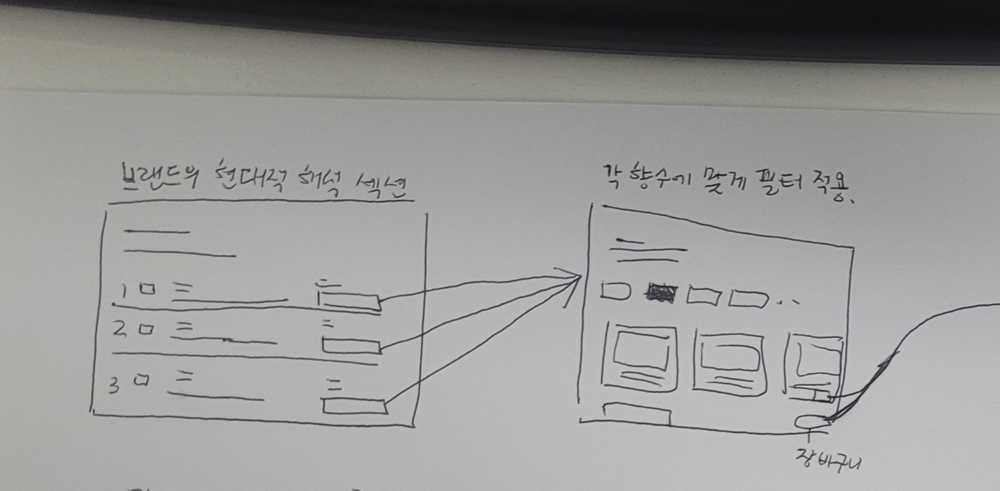
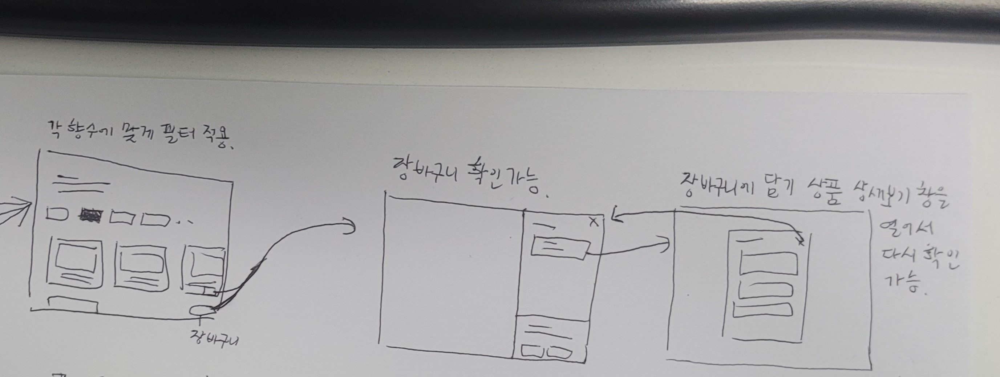
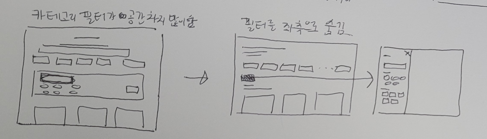
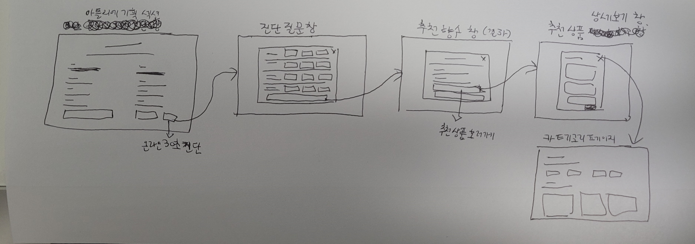

# 프로토타입 기초데이터 수집 및 스케치 제출 보고서

> 작성 기준: 2026-10-21. 같은 폴더의 수정 전·후 HTML, `1.jpg`~`4.jpg`, 레퍼런스 URL을 대조했다. 사용자 실험 기록이 없어 9장의 문제는 설계 가설로 구분했다.

## 1. 제출 정보

| 항목 | 작성 내용 |
|---|---|
| 이름 | 이은수 |
| 평가일 | 2026-10-21 |
| 프로젝트명 | 밀도(MILDO) 브랜드 소개 및 16종 상품 카탈로그 |
| 대상 매체·화면 | 반응형 웹: 브랜드 소개, 향 진단, 상품 카테고리·필터, 상품 상세·장바구니 |
| 보고서 파일명 | `03_학생_제출_산출물.md` (PDF 변환본 이름은 제출 시 확정) |
| 편집 원본 파일 또는 공유 링크 | [브랜드 소개 수정본](브랜드_소개_수정.html), [카테고리 수정본](카테고리_수정.html), 이 보고서 |
| 링크 권한 확인 시각 | 공유 링크 미제공·확인 대상 없음 |
| 사용 도구 | HTML, CSS, JavaScript, Markdown, 손그림 사진. 편집기와 촬영 기종은 확인 필요 |

## 2. 프로젝트 브리프

### 2.1 배경과 문제

- 프로젝트 배경: 조선 마패의 상징을 1·2·3마패 향수 체계로 해석한 밀도의 브랜드와 상품을 소개한다.
- 해결할 사용자 문제: 브랜드 철학, 등급별 향, 사용 상황, 16종 상품 정보를 한 흐름에서 이해하고 비교하기 어렵다. 상시 노출된 필터는 상품을 화면 아래로 밀어낼 수 있다.
- 대상 사용자와 사용 맥락: 자신의 취향에 맞는 향을 찾으려는 웹 방문자가 브랜드를 알아본 뒤 상품을 탐색하는 상황.
- 프로젝트 목표: 브랜드 이해 → 향·상황별 탐색 → 상세 확인 → 장바구니 확인의 흐름을 연결한다.
- 핵심 과업: 향 진단 또는 카테고리 선택, 검색·필터로 후보 좁히기, 상품 상세 확인, 장바구니 담기.

### 2.2 디자인 기획

| 항목 | 내용 | 이후 연결 위치 |
|---|---|---|
| 핵심 콘셉트 | 조선 마패의 헤리티지와 현대 향수의 단계별 선택 경험 | 브랜드 히어로, 마패 체계, 카테고리 탭 |
| 디자인 키워드 | 절제된 흑백, 여백, 명조 제목, 편집형 브랜드 서사 | 브랜드 소개 수정본, 두 HTML의 CSS 변수 |
| 콘텐츠 우선순위 | 정체성·등급 설명 → 상품 목록 → 상세 → 장바구니 | S-01~S-04 |
| 대상 매체의 조건 | 데스크톱·모바일 대응, 스크롤과 키보드 조작 | 반응형 CSS, 필터 서랍의 포커스 제어 |
| 제약·전제 | 상품 가격은 `[기획 가격]`이다. 실판매·효능·원료의 사실 여부는 별도 검증 필요 | 상품 카드, 11.3 |

## 3. 기초데이터 수집 계획

### 3.1 필요한 데이터

| ID | 데이터 유형 | 필요한 내용 | 사용 목적 | 우선순위 | 확보 방법 |
|---|---|---|---|---|---|
| D-01 | 프로젝트 콘텐츠 | 브랜드 서사, 1·2·3마패, 16종 상품명·향 노트·기획 가격·추천 상황 | 화면 문구·필터 항목 구성 | 높음 | 기존·수정 HTML 대조 |
| D-02 | 손그림 흐름 | 브랜드 선택, 필터, 장바구니, 아틀리에·진단·추천 연결 | 스토리보드·상태 정의 | 높음 | 사진 4장 판독 |
| D-03 | 외부 사례 | 브랜드 서사 위계와 상품 목록의 필터·카드 구조 | 비교·선정 근거 | 중간 | 폴더의 공식 사이트 URL 확인 |

### 3.2 수집 데이터 출처표

| ID | 자료명·내용 | 원출처 URL·서지정보 | 제작자 | 확인일 | 이용 조건·권리 상태 | 실제 사용 위치 |
|---|---|---|---|---|---|---|
| D-01 | [브랜드 원본](브랜드_소개.html)·[수정본](브랜드_소개_수정.html), [카테고리 원본](카테고리.html)·[수정본](카테고리_수정.html) | 같은 폴더의 로컬 HTML | 작성자 확인 필요 | 2026-10-21 | 프로젝트 내부자료, 외부 이용 권한 확인 필요 | 2, 5, 7~11장 |
| D-02 | [1.jpg](1.jpg), [2.jpg](2.jpg), [3.jpg](3.jpg), [4.jpg](4.jpg) | 같은 폴더의 손그림 사진 | 그린 사람·촬영자 확인 필요 | 2026-10-21 | 제출 이용 권한 확인 필요 | 5~7, 10장 |
| D-03 | 설화수·오설록·Byredo·Aesop 공식 웹 화면 | [설화수](https://sulwhasoo.com/about-sulwhasoo/brand-story/brand-story.html), [오설록](https://www.osulloc.com/kr/ko/brandstory), [Byredo](https://www.byredo.com/eu_en/c/perfume), [Aesop](https://kr.aesop.com/kr/fragrance/woody/) | 각 브랜드 | 2026-10-21 | 화면 구조 참고. 이미지·문구 직접 사용하지 않음 | 4장 |

### 3.3 데이터 정리와 선정

| ID | 형식·규격 | 장점 | 한계·위험 | 사용·가공·제외 결정과 이유 |
|---|---|---|---|---|
| D-01 | UTF-8 HTML, 내장 CSS·JS | 상품 정보와 동작을 코드로 대조 가능 | 기획 가격·원료·효능 문구의 외부 검증 자료 없음 | 정보구조를 채택하고 가격은 기획 상태로 표기 |
| D-02 | JPG 4장 | 화살표로 화면 연결을 확인 가능 | 일부 손글씨가 불명확하며 구현 증거는 아님 | 읽히는 흐름만 전사하고 HTML과 별도 대조 |
| D-03 | 공식 웹페이지 | 실제 사례의 장 구성·상품 필터 참고 가능 | 페이지 변경 가능, Aesop은 기능 제한 안내로 상세 조작 확인 제한 | 구조만 참고, 시각 자산과 카피는 제외 |

## 4. 레퍼런스 비교분석

### 4.1 비교 대상

| ID | 서비스·사례 | 선정 이유 | 원출처·확인일 | 비교할 화면·과업 |
|---|---|---|---|---|
| R-01 | 설화수 브랜드 스토리 | 브랜드를 장별로 설명 | [공식 페이지](https://sulwhasoo.com/about-sulwhasoo/brand-story/brand-story.html), 2026-10-21 | 서사·여백 |
| R-02 | 오설록 스토리 | 산지·원료를 시각 자료와 연결 | [공식 페이지](https://www.osulloc.com/kr/ko/brandstory), 2026-10-21 | 원료 이야기 |
| R-03 | Byredo 향수 목록 | 상품 목록 위의 필터 진입·카드 | [공식 페이지](https://www.byredo.com/eu_en/c/perfume), 2026-10-21 | 필터·상품 카드 |
| R-04 | Aesop 우디 향수 | 향 계열 중심 진입 사례 | [공식 페이지](https://kr.aesop.com/kr/fragrance/woody/), 2026-10-21 | 향 분류. 세부 조작은 확인 보류 |

### 4.2 공통 기준 비교

| 비교 기준 | R-01 | R-02 | R-03 | 우리 프로젝트의 판단 |
|---|---|---|---|---|
| 정보구조·레이블 | 브랜드 스토리 분리 | 자연·차밭 이야기 분리 | Perfume 목록·상품 범주 구분 | 브랜드와 16종 카탈로그를 분리하고 마패 등급 유지 |
| 내비게이션·이동성 | 상단 메뉴에서 진입 | 제품·브랜드 이야기 이동 | 목록 상단 필터 진입 | 카테고리 탭·필터 버튼을 목록 가까이에 배치 |
| 인터페이스·조작 | 스크롤로 서사 읽기 | 이미지와 본문 읽기 | `Filters (0)`·상품 카드 | 필터 버튼·적용 조건 수·상품 수 표시 |
| 콘텐츠 위계 | 브랜드 주제별 전개 | 산지·환경 설명 전개 | 목록 제목·상품 카드 우선 | 브랜드는 편집형 장, 카테고리는 상품 우선 |
| 비주얼·그래픽 | 브랜드 이미지 중심 | 자연 이미지 중심 | 제품 이미지 중심 | 흑백·여백 중심으로 재구성. 일부 시각 영역은 자리표시자 |
| 피드백·상태 | 읽기 중심 | 읽기 중심 | 필터·장바구니 개수 | 필터 수·결과 수·무결과·장바구니 상태 표시 |

### 4.3 적용 결정

| 원리·패턴 | 적용 | 변형 | 제외 | 결정 이유 | 적용할 화면 |
|---|:---:|:---:|:---:|---|---|
| 브랜드 이야기를 장별로 읽기 | ✓ |  |  | 마패 역사·현대적 해석·원료를 순서대로 전달 | 브랜드 소개 |
| 상품 목록과 필터 진입을 함께 배치 |  | ✓ |  | 상품을 먼저 보이고 필터를 왼쪽 서랍으로 열기 | 카테고리 |
| 외부 이미지·문구 직접 사용 |  |  | ✓ | 이용 권한과 브랜드 일관성 확인 전에는 구조만 참고 | 전체 |

## 5. 핵심 과업과 스토리보드

### 5.1 과업 정의

| 항목 | 내용 |
|---|---|
| 수행자 역할 | 향수 구매를 검토하는 웹 방문자 |
| 시작 상황 | 밀도의 브랜드·상품을 모르는 상태로 소개 또는 카테고리에 진입 |
| 달성할 목표 | 취향·상황에 맞는 상품을 찾아 상세 확인 후 장바구니에 담기 |
| 성공 조건 | 선택 조건과 결과를 이해하고 장바구니에서 같은 상품·개수·합계를 확인 |
| 예상 제약·오류 | 무결과 필터 조합, 진단 미응답, 모바일의 긴 정보, 수정본에서 원본으로 이동하는 링크 |

### 5.2 화면 흐름 요약

`브랜드 소개 또는 카테고리 → (선택) 4문항 향 진단 → 카테고리 필터·상품 목록 → 상품 상세 → 장바구니 확인`. 결과가 0개면 필터를 바꾸거나 초기화한다. [1.jpg](1.jpg)·[2.jpg](2.jpg)는 브랜드 선택→맞춤 필터→장바구니, [3.jpg](3.jpg)는 필터 배치 대안, [4.jpg](4.jpg)는 아틀리에 기획→진단→추천 상품의 스케치다.

### 5.3 스토리보드

| 화면 ID | 화면 목적 | 주요 콘텐츠·요소 | 사용자 행동 | 시스템 결과·피드백 | 다음 화면·분기 | 모션·시간 표현 |
|---|---|---|---|---|---|---|
| S-01 | 브랜드·마패 체계 이해 | 히어로, 마패 설명, 향 진단 진입 | 읽고 진단 또는 카테고리 선택 | 진단 모달 열림 또는 페이지 이동 | S-02·S-03 | 스크롤 |
| S-02 | 취향 확인 | 4문항, 답변 수, 결과 처방전 | 질문 선택·완료 | 미응답 안내 또는 추천 표시 | S-03 | `0 / 4` 상태·미응답 위치 이동 |
| S-03 | 상품 탐색 | 탭, 필터 서랍, 카드, 결과 수 | 향·상황·키워드 선택 | 목록·필터 수 갱신, 0개면 초기화 안내 | S-04·S-03 | 서랍 슬라이드 |
| S-04 | 상세·장바구니 확인 | 상세 모달, 상품 목록·합계 | 상세 확인·담기 | 개수·합계 갱신, 상세 재열람 | 완료·S-03 | 장바구니 서랍 슬라이드 |

**브랜드 선택부터 장바구니까지의 손그림 흐름**

## 6. 아이디어 발상과 썸네일 스케치

### 6.1 발상 과정

- 사용한 발상 방법: 화면 간 화살표로 진입·확인·복귀를 구분하고 수정 전후 HTML의 배치와 대조.
- 도출한 핵심 단어·아이디어: 마패 등급, 맞춤 필터, 상품 먼저 보기, 장바구니 상세, 아틀리에·진단·추천.
- 스케치에서 확인할 질문: 필터를 찾을 수 있는가? 필터가 상품을 가리는가? 추천 후 상품으로 이어지는가?

### 6.2 화면별 대안

| 스케치 ID | 대응 화면 | 대안의 핵심 차이 | 장점 | 한계 |
|---|---|---|---|---|
| T-S01-A | S-01 | 브랜드의 1·2·3마패 선택을 먼저 제시 — 1·2.jpg | 등급별 목적이 분명함 | 설명이 길면 상품 진입이 늦어짐 |
| T-S03-A | S-03 | 필터를 목록 위에 계속 펼침 — 3.jpg 왼쪽 | 조건을 바로 볼 수 있음 | 상품이 아래로 밀림 |
| T-S03-B | S-03 | 상품 목록과 별도 필터 서랍 — 3.jpg 오른쪽 | 상품을 먼저 봄 | 필터 버튼을 쉽게 찾아야 함 |
| T-S02-A | S-02 | 아틀리에 기획→진단→추천 — 4.jpg | 브랜드 경험과 추천 연결 | 전 경로의 HTML 구현 여부 추가 확인 필요 |

**필터 배치 대안과 아틀리에 흐름**

### 6.3 대안 비교와 선정

| 비교 기준 | 대안 A: 상시 필터 | 대안 B: 필터 서랍 | 대안 C: 향 진단 | 선택·조합 결과 |
|---|---|---|---|---|
| 사용자 목표 지원 | 조건 즉시 조정 | 상품 먼저 탐색 | 취향 미정 사용자 지원 | B 기본·C 보조 |
| 정보 위계 | 필터 우선 | 목록 우선 | 질문 우선 | 목록 우선 채택 |
| 조작 명확성 | 조건 항상 표시 | `필터 열기` 필요 | 완료·재시작 필요 | 버튼·상태 수 표시 |
| 흐름 연결 | 목록으로 | 목록·상세로 | 추천 상품으로 | 브랜드→진단→카테고리 |
| 구현 가능성 | 기존 패널 활용 | 기존 필터를 서랍으로 변경 | 기존 진단 모달 활용 | 수정본에 B·C 일부 구현 |

- 최종 방향과 이유: 상품 탐색은 필터 서랍을 기본으로 하고 취향을 모르는 방문자는 브랜드 소개의 향 진단으로 안내한다.

## 7. 저충실도 세부 시안

### 7.1 화면·상태 목록

| 시안 ID | 대응 스토리보드 | 화면·상태 | 사용 데이터 | 주요 기능 | 다음 연결 |
|---|---|---|---|---|---|
| W-01 | S-01 | 브랜드 소개·마패 체계 | D-01·D-03 | 읽기, 진단·카테고리 진입 | W-02·W-03 |
| W-02 | S-02 | 진단 기본·미응답·결과 | D-01·D-02 | 4문항·추천 | W-03 |
| W-03 | S-03 | 상품 목록·필터 열림·무결과 | D-01~D-03 | 향·상황·검색, 결과 수 | W-04·재설정 |
| W-04 | S-04 | 상품 상세·장바구니 | D-01·D-02 | 상세·담기·합계 | W-03·종료 |

저충실도 근거는 [1.jpg](1.jpg)~[4.jpg](4.jpg)이며, 두 수정 HTML은 이를 구체화한 웹 시안이다.

### 7.2 구현 주석

| 시안 ID·요소 | 콘텐츠·기능 | 입력·행동 | 상태·피드백 | 구현 제약·미결정 |
|---|---|---|---|---|
| W-02·향 진단 | 4문항 한 화면 | 문항별 단일 선택·완료 | 답변 수, 미응답 안내·포커스 이동 | 추천 적합성은 사용자 검증 필요 |
| W-03·필터 서랍 | 검색·향·상황 | 열기, 선택, 닫기 | 조건 즉시 반영, 적용 수·결과 수·0건 안내 | `상품 보기`는 적용이 아니라 닫기 동작이라 문구 검증 필요 |
| W-04·장바구니 | 선택 상품·개수·합계 | 상품 담기·상세 재열람 | 서랍 내용 갱신 | 실제 결제 연동은 확인 필요 |

## 8. 전달 매체와 시각·모션 방향

| 항목 | 결정 | 적용 화면 | 선택 근거 |
|---|---|---|---|
| 화면 크기·방향 | 반응형 세로 스크롤 웹, 필터 서랍 최대 430px·92vw | 전체 | 모바일·데스크톱에 같은 탐색 구조 |
| 그리드·여백 | 브랜드 히어로 2열과 넓은 장 간격, 카테고리 목록 우선 | W-01·W-03 | 읽기와 상품 탐색의 목적 구분 |
| 타이포그래피 | Pretendard 계열 본문, Nanum Myeongjo 계열 제목, 대체 글꼴 지정 | 전체 | 전통적 제목 인상과 본문 가독성 |
| 컬러 | 흰색·연회색 바탕, 검정·회색 강조. `--accent-brass`도 수정본에서는 `#111111` | 전체 | 수정본의 흑백 중심 방향 |
| 이미지·텍스처 | 히어로·헤리티지·원료 영역에 큰 시각 공간 | W-01 | 일부 빈 배경·자리표시자라 최종 이미지 필요 |
| 아이콘·그래픽 | 마패 배지, 필터·닫기 버튼, 상품 카드 | 전체 | 텍스트와 함께 조작·상태 구분 |

### 필요한 모션

| 모션 ID | 발생 조건 | 대상·변화 | 목적 | 예상 시간 | 모션을 볼 수 없을 때의 대체 표현 |
|---|---|---|---|---|---|
| M-01 | 필터 열기·닫기 | 왼쪽 서랍 이동·배경 덮개 | 목록과 필터 영역 구분 | CSS 0.28초, 덮개 0.25초 | 열린 서랍 제목·닫기 버튼·`aria-expanded` |
| M-02 | 장바구니 열기 | 오른쪽 서랍 이동 | 선택 상품 확인 | CSS 0.3초 | 제목·상품 수·합계 텍스트 |

## 9. 사용성 점검

### 9.1 점검 계획

| 항목 | 내용 |
|---|---|
| 점검 목적 | 브랜드 이해, 필터 발견, 상품 찾기, 장바구니 확인 흐름 점검 |
| 수행자 역할·번호 | 실제 참여자 미기록. 향수 구매 검토자 P-01~P-03 모집 예정 |
| 사용한 결과물 버전 | 두 `_수정.html` 파일 |
| 핵심 과업 | 브랜드에서 향 찾기 → 카테고리에서 좁히기 → 상세·장바구니 확인 |
| 성공 조건 | 도움 없이 상품을 찾고 선택 상품·개수·합계를 설명 |
| 진행 방식 | 데스크톱·모바일에서 과업 수행, 조작·발언·시간·막힌 지점 기록 예정 |
| 질문·관찰 항목 | 필터 발견, 적용 시점 이해, 수정본 간 이동 여부 |

### 9.2 관찰 원자료

실제 참여자 관찰 기록은 제공되지 않았다. 아래는 **자료·코드 점검 기록**이다.

| 단계·시간 | 수행자 행동·발언 | 관찰 사실 | 도움 제공 여부 | 결과 |
|---|---|---|---|---|
| 자료 점검·2026-10-21 | 해당 없음 | 3.jpg에 필터 배치 두 구상이 있고 수정본은 왼쪽 서랍 채택 | 해당 없음 | 변경 근거 확인 |
| 코드 점검·2026-10-21 | 해당 없음 | 필터 선택은 즉시 목록에 반영되고 `상품 보기`는 서랍을 닫음 | 해당 없음 | 문구 이해도 검증 필요 |
| 코드 점검·2026-10-21 | 해당 없음 | 수정본의 페이지 간 링크 상당수가 `_수정.html` 대신 원본 HTML을 가리킴 | 해당 없음 | 제출 경로 확인 필요 |

### 9.3 프로젝트의 사용성 기준

- 효과성: 조건에 맞는 상품을 찾아 상세와 장바구니에서 같은 상품을 확인한다.
- 효율성: 조건 변경 후 결과 수와 목록을 쉽게 확인한다. 시간 목표는 사용자 점검 후 정한다.
- 이해·학습 용이성: 필터 개수, 4문항 진행 상태, 무결과의 초기화 방법을 이해한다.
- 만족 또는 신뢰: `[기획 가격]`과 미검증 상품 정보의 기획 상태를 오해하지 않는다.

### 9.4 문제 도출

U-01·U-02는 사용자 관찰 결과가 아닌 **수정 전후·스케치 비교에 따른 설계 가설**이다.

| 문제 ID | 관찰 근거 | 문제 진술 | 영향 화면·과업 | 원인 가설 | 우선순위 |
|---|---|---|---|---|---|
| U-01 | 3.jpg와 카테고리 원본·수정본 비교 | 상시 필터가 첫 화면의 상품 탐색을 늦출 수 있음 | S-03 | 검색·향·상황 조건이 상품 앞에 길게 노출 | 높음 |
| U-02 | 브랜드 원본·수정본의 히어로·본문 비교 | 긴 설명이 핵심 메시지와 등급 체계를 흐릴 수 있음 | S-01 | 제목·시각 자료·본문의 위계와 여백 | 중간 |

## 10. 수정과 재확인

| 문제 ID | 수정 전 | 수정 내용 | 수정 이유 | 수정 후 | 반영·보류 | 재확인 결과 |
|---|---|---|---|---|---|---|
| U-01 | 카테고리 원본의 상시 필터 패널 | 짧은 목록 도입부, `필터 열기`, 왼쪽 서랍, 적용 수·초기화 버튼 | 상품을 먼저 보이고 조건은 필요할 때 조정 | 필터와 상품 목록이 분리됨 | 반영 | HTML·CSS·JS 정적 대조 완료, 사용자 과업 검증 미실시 |
| U-02 | 브랜드 원본의 히어로·설명 배치 | 히어로 2열, 핵심 정보 4칸, 넓은 여백, 편집형 헤리티지 장, 흑백 톤 | 브랜드 메시지와 역사·현대적 해석을 단계적으로 전달 | 콘텐츠 위계 변경 확인 | 반영 | 코드 비교 완료, 실제 가독성 검증 미실시 |

수정 전후 원본: [브랜드 전](브랜드_소개.html) → [브랜드 후](브랜드_소개_수정.html), [카테고리 전](카테고리.html) → [카테고리 후](카테고리_수정.html). 필터 배치의 손그림 근거는 [3.jpg](3.jpg)이다.

## 11. 최종 종합 패키지

### 11.1 대응표

| 브리프 요구 | 데이터·레퍼런스 | 스토리보드 | 썸네일 | 최종 시안 | 사용성 수정 |
|---|---|---|---|---|---|
| 브랜드 이해·향 추천 | D-01·D-02, R-01·R-02 | S-01·S-02 | T-S01-A·T-S02-A | W-01·W-02, 브랜드 수정본 | U-02 |
| 상품 탐색·장바구니 | D-01~D-03, R-03 | S-03·S-04 | T-S03-A·T-S03-B | W-03·W-04, 카테고리 수정본 | U-01 |

### 11.2 파일 구조와 버전

| 파일·페이지·프레임 | 내용 | 버전·수정일 | 비고 |
|---|---|---|---|
| `브랜드_소개.html`, `카테고리.html` | 수정 전 비교 기준 | 원본·2026-10-21 확인 | 같은 폴더 |
| `브랜드_소개_수정.html` | 브랜드·향 진단 시안 | 수정본·2026-10-21 확인 | 링크는 원본 파일명 참조 가능 |
| `카테고리_수정.html` | 목록·필터·상품·장바구니 시안 | 수정본·2026-10-21 확인 | 독립 HTML |
| `1.jpg`~`4.jpg` | 손그림 스토리보드·대안 | 2026-10-21 확인 | 이 문서에 네 장 삽입 |
| `03_학생_제출_산출물.md` | 편집 원본 보고서 | 2026-10-21 | PDF 변환·열람은 제출 시 확인 |

### 11.3 남은 위험과 다음 단계

- 아직 확인하지 못한 가정: 필터 발견성과 즉시 반영 방식의 이해도, `상품 보기` 문구의 의미, 향 진단 추천의 적절성.
- 추가로 필요한 데이터: 작성자·사진 제작자, 실제 사용자 관찰 기록, 원료·가격·효능 표현의 근거, 최종 이미지와 이용 권한.
- 다음 프로토타입 단계에서 검증할 내용: 두 수정본 간 링크, 모바일·키보드 탐색, 빈 결과·진단 미응답·장바구니 상태, 실제 사용자 과업.

## 12. 최종 제출 확인

### 데이터·분석

- [ ] 출처·확인일·제작자·이용 조건을 기록했습니다. (로컬 자료 제작자·권리 확인 필요)
- [x] 레퍼런스를 같은 기준으로 비교했습니다. (R-04 상세 조작은 보류)
- [x] 장단점과 적용·변형·제외 판단을 남겼습니다.

### 스토리보드·스케치

- [x] 핵심 과업의 시작·진행·완료와 회복 상태를 연결했습니다.
- [x] 카테고리 화면의 의미 있는 필터 배치 대안을 비교했습니다.
- [x] 화면·스케치·시안 번호를 서로 대응시켰습니다.
- [x] 구현 주석에 입력·상태·미결정 사항을 남겼습니다.

### 점검·수정·제출

- [ ] 실제 사용자 점검의 관찰 원자료가 있습니다. (계획만 작성, 실험 미실시)
- [x] 설계 문제 가설과 수정 전후를 연결했습니다. (사용자 검증 미실시)
- [ ] 보고서 PDF와 편집 원본을 모두 열어 보았습니다. (PDF 변환 후 확인 필요)
- [x] 공유 링크가 없다면 그 상태를 명시했습니다. (공유 링크 없음)
