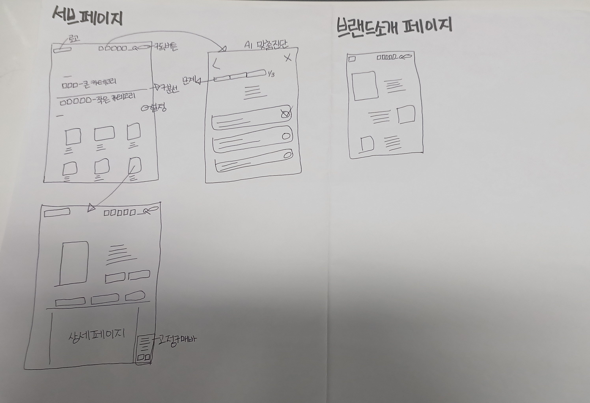

# 프로토타입 기초데이터 수집 및 스케치 제출 보고서

> 이 문서를 복사하여 작성한 뒤 PDF로 제출하세요. 불필요한 안내 문장은 삭제해도 되지만 제목과 증빙 항목은 유지합니다.

## 1. 제출 정보

| 항목 | 작성 내용 |
|---|---|
| 이름 | 허지민 |
| 평가일 | 2026-10-21 |
| 프로젝트명 | A:FIT — 내 생활에 맞추는 이중제형 웰니스 웹 |
| 대상 매체·화면 | 반응형 웹 · 메인, 제품 컬렉션, 맞춤 질문·결과, 제품 상세, 브랜드 소개 |
| 보고서 파일명 | 보고서.md · PDF 변환 전 |
| 편집 원본 파일 또는 공유 링크 | 본 Markdown 문서, 메인페이지.html, 03_AI초안 및 04_AI수정안 폴더의 HTML 원본 |
| 링크 권한 확인 시각 | 외부 공유 링크 없음 · 로컬 파일 기준 작성 |
| 사용 도구 | 종이·필기구, HTML·CSS·JavaScript, AI 작성 보조(Codex), Markdown |

## 2. 프로젝트 브리프

### 2.1 배경과 문제

- 프로젝트 배경: A:FIT은 바쁜 일상 속에서 여러 제품을 따로 챙기는 번거로움을 줄이고, 생활에 맞는 제품 구성을 탐색하도록 제안하는 이중제형 웰니스 브랜드 웹 프로젝트이다.
- 해결할 사용자 문제: 방문자가 제품의 차이와 선택 기준을 파악하기 어렵고 상단 정제·하단 액상 구조를 쉽게 이해하지 못할 수 있다는 설계 가설을 다룬다. 별도 사용자 조사로 검증된 사실은 아니다.
- 대상 사용자와 사용 맥락: 끼니와 영양제를 규칙적으로 챙기기 어려운 직장인 등, PC나 모바일에서 간편한 제품을 비교하고 생활 루틴에 맞는 구성을 알아보는 방문자.
- 프로젝트 목표: 생활 중심 선택 기준, 짧은 질문 흐름, 구성과 주의 안내를 통해 방문자가 선택 이유를 이해하고 제품 탐색을 이어가도록 한다.
- 핵심 과업: 제품 목록 또는 메인에서 맞춤 질문에 진입하고 3개 질문에 응답한 뒤, 제안 결과의 선택 이유와 이중제형 구성을 확인한다.

### 2.2 디자인 기획

| 항목 | 내용 | 이후 연결 위치 |
|---|---|---|
| 핵심 콘셉트 | 상단 정제와 하단 액상을 한 병에 담는 제품 콘셉트와 생활 중심 선택 경험 | S-03 제품 상세, S-04 브랜드 소개 |
| 디자인 키워드 | 일상성, 간편함, 명료함, 차분한 그린, 여백 | 제품 목록·상세와 브랜드 서사 |
| 콘텐츠 우선순위 | 선택 기준 → 제품 비교 → 구성·선택 이유 → 주의사항 → 구독 구성 확인 | S-01 → S-02 → S-03 |
| 대상 매체의 조건 | PC의 다열 카드와 모바일의 축소 그리드, 세로 스크롤, 질문 대화상자 | 전체 화면 |
| 제약·전제 | 제품·가격은 기획 예시. 성분·함량·효능 및 인증은 검증 전이며 실제 주문·의학적 판단 기능은 범위 밖 | 상세 안내와 결과 문구 |

## 3. 기초데이터 수집 계획

### 3.1 필요한 데이터

| ID | 데이터 유형 | 필요한 내용 | 사용 목적 | 우선순위 | 확보 방법 |
|---|---|---|---|---|---|
| D-01 | 레퍼런스 화면·출처 | 상품 추천 구조와 브랜드 소개의 정보 위계 | 공통 기준 비교와 화면 구성 | 높음 | 제공 JPG 및 링크_메모장_정리.txt 확인 |
| D-02 | 초기 설계 이미지 | 목록·진단·상세·브랜드 소개의 배치와 이동 관계 | 화면 ID 부여와 흐름 정의 | 높음 | 스토리보드_스케치.jpg 판독 |
| D-03 | HTML 초안·수정안 | 제품 데이터, 질문 문구, 필터, 상세 탭, 상태 안내 | 설계 구체화와 수정 전후 비교 | 높음 | 메인 및 03_AI초안·04_AI수정안 코드 대조 |

### 3.2 수집 데이터 출처표

| ID | 자료명·내용 | 원출처 URL·서지정보 | 제작자 | 확인일 | 이용 조건·권리 상태 | 실제 사용 위치 |
|---|---|---|---|---|---|---|
| D-01 | 일루미엘 추천 화면, 바디럽·웰킨 브랜드 화면 | 제공 링크 메모: https://illumiel.co.kr/ ; https://bodyluv.kr/event/detail.html?product_no=647&cate_no=1&display_group=22 ; https://wellkinmall.co.kr/service/story_brand | 각 사이트 화면 제작자 미확인 | 2026-10-21 제공 캡처 확인 · 원사이트 재확인 안 함 | 외부 이미지·문구 권리 및 재사용 허가 미확인. 구조 분석에 사용 | 4장 R-01~R-03 |
| D-02 | 스토리보드_스케치.jpg | 프로젝트 폴더 내 동명 파일 | 허지민 제공 스케치 | 2026-10-21 | 사용자 제공 자료. 타인 소재 포함 여부 별도 확인 필요 | 5장·7장 이미지 증빙 |
| D-03 | 메인페이지.html, 03_AI초안 및 04_AI수정안의 브랜드·서브 HTML | 프로젝트 폴더 내 HTML 원본 5개 | 프로젝트 제공 파일 · AI 초안·수정안 표기 | 2026-10-21 코드 확인 | 과제 설계 자료. 실제 제품 정보·인증·이미지 권리의 검증 자료로 사용하지 않음 | 7~10장 및 11장 |

### 3.3 데이터 정리와 선정

| ID | 형식·규격 | 장점 | 한계·위험 | 사용·가공·제외 결정과 이유 |
|---|---|---|---|---|
| D-01 | JPG 캡처 8장과 TXT 링크 메모 중 비교 목적에 맞는 3개 사례 선정 | 이미지·카드·문구의 관계를 직접 비교 가능 | 캡처만으로 실제 조작·반응형 동작은 확인 불가 | 추천은 일루미엘, 브랜드 소개는 바디럽·웰킨을 선정. 원문·제품 사진 복제 제외 |
| D-02 | JPG 손그림 · 목록·질문 1/3·상세·브랜드 소개 | 초기 정보 배치와 이동 의도를 확인 가능 | 질문 2·3과 결과의 독립 스케치, 복수 대안 증빙 부족 | 원본 이미지를 유지하고 S-01~S-04 설명과 연결. 없는 그림을 제작 완료로 처리하지 않음 |
| D-03 | UTF-8 HTML·CSS·JavaScript | 실제 요소명·조건 분기·수정 전후를 추적 가능 | 실행 검증 전이며 파일명과 연결 경로가 일치하지 않는 부분 존재 | 화면 설명과 코드 기반 점검에 사용. 성분·효능 수치를 확정 정보로 채택하지 않음 |

## 4. 레퍼런스 비교분석

### 4.1 비교 대상

| ID | 서비스·사례 | 선정 이유 | 원출처·확인일 | 비교할 화면·과업 |
|---|---|---|---|---|
| R-01 | 일루미엘 맞춤형 제품 추천 · 서브페이지_레퍼런스01.jpg | 고민 선택과 상품 카드 비교 구조 참고 | https://illumiel.co.kr/ · 제공 캡처 확인 2026-10-21 | 추천 기준 → 제품명·가격·리뷰 탐색 |
| R-02 | 바디럽 브랜드 소개 · 브랜드소개_레퍼런스01.jpg | 생활 이미지와 짧은 공감 메시지의 관계 참고 | https://bodyluv.kr/event/detail.html?product_no=647&cate_no=1&display_group=22 · 제공 캡처 확인 2026-10-21 | 브랜드 첫인상과 가치 이해 |
| R-03 | 웰킨 브랜드 스토리 · 브랜드소개_레퍼런스02.jpg | 문제 공감에서 브랜드 관점으로 이어지는 서사 참고 | https://wellkinmall.co.kr/service/story_brand · 제공 캡처 확인 2026-10-21 | 긴 설명을 이미지·문단 단위로 읽기 |

### 4.2 공통 기준 비교

| 비교 기준 | R-01 | R-02 | R-03 | 우리 프로젝트의 판단 |
|---|---|---|---|---|
| 정보구조·레이블 | 고민별 추천 항목과 제품 카드 | 생활 문제를 중심으로 한 소개 문구 | 브랜드 스토리 제목과 문단별 설명 | 목록은 선택 기준과 상품, 소개는 공감과 제품 원리로 구분 |
| 내비게이션·이동성 | 왼쪽 선택 항목과 화살표 표시 | 닫기와 우측 화면 위치 표시가 보임 | 세로로 이어지는 이미지·문단 | 공통 상단 메뉴와 목록 복귀 경로 제공. 원 사례의 실제 이동 동작은 미검증 |
| 인터페이스·조작 | 선택된 고민 항목의 짙은 색 강조 | 큰 이미지 위 읽기 중심 화면 | 이미지 옆 텍스트를 따라 읽는 화면 | 필터·카드는 조작형, 브랜드 소개는 읽기형으로 설계 |
| 콘텐츠 위계 | 추천 제목 → 상품 사진 → 이름·가격·리뷰 | 큰 인사 문구 → 짧은 브랜드 설명 | 제목 → 일상 문제 → 브랜드 관점 | 상세에서 제품명·구성·선택 이유를 먼저 배치 |
| 비주얼·그래픽 | 그린 계열, 균일한 제품 영역, 넓은 여백 | 생활 사진과 밝은 블루 | 흰 여백, 사진과 설명의 교차 배치 | 그린과 중립 배경을 사용하고 소개의 시각적 리듬을 차용 |
| 피드백·상태 | 선택 항목의 색 차이 확인 | 캡처에서 과업 완료 상태 확인 불가 | 캡처에서 조작 피드백 확인 불가 | 단계 수·결과·빈 목록·상세 선택 상태를 별도로 명시 |

### 4.3 적용 결정

| 원리·패턴 | 적용 | 변형 | 제외 | 결정 이유 | 적용할 화면 |
|---|:---:|:---:|:---:|---|---|
| 고민별 추천 항목과 선택 강조 |  | O |  | 피부 고민을 생활·관심사 기준으로 바꾸어 선택 부담 감소 | S-01 목록, S-02 질문 |
| 생활 공감 메시지와 이미지·설명 교차 구성 | O |  |  | 제품 기술 설명 전에 사용 맥락을 이해하도록 구성 | S-04 브랜드 소개 |
| 원 사례의 상품 사진·효능·리뷰 수치 복사 |  |  | O | 다른 제품의 근거를 A:FIT의 실제 사실로 사용할 수 없음 | 전체 |

## 5. 핵심 과업과 스토리보드

### 5.1 과업 정의

| 항목 | 내용 |
|---|---|
| 수행자 역할 | 바쁜 일상에서 간편한 영양 관리 제품을 탐색하는 방문자 |
| 시작 상황 | 브랜드 메인 또는 컬렉션에 진입했으나 어떤 제품을 골라야 할지 모름 |
| 달성할 목표 | 생활 질문 3개에 답한 뒤 제안된 제품과 선택 이유·구성을 확인 |
| 성공 조건 | 도움 없이 결과에 도달하고 상단 정제·하단 액상 구조와 기획 예시 안내를 찾음 |
| 예상 제약·오류 | 이전 답 수정, 조건에 맞는 상품 없음, 닫은 뒤 재시작, 파일명 불일치로 페이지 이동 실패 |

### 5.2 화면 흐름 요약

`S-01 메인·제품 목록 → S-02 질문 1/3 → 2/3 → 3/3 → 제안 결과 → S-03 선택 이유·구성 확인 → 목록 복귀 또는 다시 하기; 브랜드 메뉴 → S-04 소개 → 목록`

### 5.3 스토리보드

| 화면 ID | 화면 목적 | 주요 콘텐츠·요소 | 사용자 행동 | 시스템 결과·피드백 | 다음 화면·분기 | 모션·시간 표현 |
|---|---|---|---|---|---|---|
| S-01 | 제품 탐색 진입 | 상단 메뉴, 대·소분류, 제품 카드, 맞춤 질문 진입 | 분류·제품·질문 버튼 선택 | 목록 또는 질문·상세 표시 | S-02 또는 S-03, 브랜드 메뉴는 S-04 | 초기 손그림에 시간 표기 없음 |
| S-02 | 질문 응답과 조합 제안 | 1/3~3/3 진행 표시, 단일 선택지, 이전·닫기, 결과와 다시 하기 | 생활·선택 기준·복용 여부 선택 | 선택 후 다음 질문, 3개 응답 후 제안 결과와 응답 요약 | 구성 보기 → S-03, 다시 하기 → 질문 1 | 수정안은 결과로 즉시 전환. 별도 분석 대기 상태 없음 |
| S-03 | 제품 구성 이해 | 제품 이미지·이름, 상세 탭, 상단 정제·하단 액상, 주의 안내, 구독 구성 | 탭 선택·목록 복귀·구독 구성 열기 | 선택 탭 내용과 기획 예시 안내 표시 | S-01 또는 구독 구성 대화상자 | 동작 시간은 구현 후 측정 |
| S-04 | 브랜드 가치 이해 | 생활 공감 메시지, 이미지·설명 구획, 제품 컬렉션 연결 | 스크롤하며 읽고 제품 탐색 선택 | 브랜드 설명과 탐색 경로 제공 | S-01 | 읽기를 방해하는 자동 전환은 사용하지 않는 방향 |

스토리보드 이미지 또는 원본 캡처를 아래에 배치합니다.

> 이미지 삽입

S-01은 왼쪽 위 목록, S-02는 가운데 질문 1/3, S-03은 왼쪽 아래 상세, S-04는 오른쪽 소개에 대응한다. ID는 보고서에서 부여했다. 질문 2·3과 결과 설명은 HTML 수정안을 근거로 보완한 설계이며 원본 손그림에 추가된 그림은 아니다.

## 6. 아이디어 발상과 썸네일 스케치

### 6.1 발상 과정

- 사용한 발상 방법: 손그림의 화면 분해와 레퍼런스의 공통 기준 비교를 바탕으로, 첫 진입에서 제품·질문·브랜드 설명 중 무엇을 우선할지 세 가지 대안을 정리했다. 초기 제작자의 구체적인 발상 절차는 별도 기록이 없다.
- 도출한 핵심 단어·아이디어: 생활 중심 선택, 간편한 한 병, 한 번에 한 질문, 비교 가능한 카드, 선택 이유, 상단 정제·하단 액상, 기획 예시의 명시.
- 스케치에서 확인할 질문: 제품과 맞춤 질문 진입을 함께 찾을 수 있는가? 답 선택 후 현재 단계를 알 수 있는가? 결과에서 구성과 주의 안내로 자연스럽게 이어지는가?

### 6.2 화면별 대안

각 스케치에 `T-화면번호-대안번호`를 붙입니다. 예: `T-S01-A`.

| 스케치 ID | 대응 화면 | 대안의 핵심 차이 | 장점 | 한계 |
|---|---|---|---|---|
| T-S01-A | S-01 | 제품 카드 중심 목록안 · 손그림에 해당 | 여러 제품을 같은 형식으로 비교 가능 | 선택 기준 설명이 부족하면 탐색량 증가 |
| T-S01-B | S-01·S-02 | 질문을 먼저 제시하는 대안 · 본 보고서에서 제안, 별도 스케치 미제작 | 초행 사용자에게 선택 출발점 제공 | 제품을 바로 보려는 사용자에게 우회 경로 필요 |
| T-S01-C | S-01·S-04 | 브랜드 설명 후 제품 목록을 제시하는 대안 · 본 보고서에서 제안, 별도 스케치 미제작 | 브랜드 맥락과 제품 원리 전달에 유리 | 제품 탐색까지 스크롤이 길어짐 |

> 썸네일 스케치 스캔·사진 또는 캡처 삽입

T-S01-B·C는 본문에서 비교한 신규 설계 대안이며 별도 썸네일 이미지 증빙은 아직 없다.

### 6.3 대안 비교와 선정

| 비교 기준 | 대안 A | 대안 B | 대안 C | 선택·조합 결과 |
|---|---|---|---|---|
| 사용자 목표 지원 | 원하는 제품을 직접 비교 | 질문으로 탐색 범위를 축소 | 브랜드 이해 후 제품 탐색 | A를 기본으로 B 진입 버튼 제공 |
| 정보 위계 | 제품명·구성·가격 우선 | 질문·선택지 우선 | 메시지·이미지 우선 | 목록·질문·소개를 목적에 따라 구분 |
| 조작 명확성 | 분류와 카드의 클릭 영역 필요 | 한 질문에 한 답을 고르게 구성 | 읽기 이후 행동 버튼 필요 | 카드와 단일 선택 버튼을 분명히 표시 |
| 흐름 연결 | 목록 → 상세가 짧음 | 질문 → 결과 → 상세 연결 | 소개 → 컬렉션 연결 | 공통 메뉴와 상세 복귀 경로로 연결 |
| 구현 가능성 | 기존 HTML 목록 구조 활용 | 수정안의 3단계 질문 활용 | 별도 브랜드 소개 HTML 활용 | A+B 조합, C는 별도 소개 페이지. 비교는 설계 판단이며 사용자 실험 결과 아님 |

- 최종 방향과 이유: 제품 카드 중심 A를 기본으로 질문 중심 B에 바로 진입하도록 조합한다. 직접 비교와 선택 도움을 함께 제공하고, 브랜드 설명 C는 별도 소개로 연결해 탐색 목적별로 읽는 순서를 고를 수 있게 한다. 이는 보고서의 설계 제안이며 사용자 선호가 검증된 결과는 아니다.

## 7. 저충실도 세부 시안

### 7.1 화면·상태 목록

| 시안 ID | 대응 스토리보드 | 화면·상태 | 사용 데이터 | 주요 기능 | 다음 연결 |
|---|---|---|---|---|---|
| W-01 | S-01 | 제품 목록·필터 선택·빈 목록 | D-01·D-02·D-03 | 분류, 정렬, 카드, 페이지 이동, 초기화 | W-02 또는 W-03 |
| W-02 | S-02 | 질문 1~3·이전·결과 | D-02·D-03 | 단일 선택, 응답 요약, 제안 제품, 다시 하기 | W-03 |
| W-03 | S-03·S-04 | 상세·주의 안내와 브랜드 소개 | D-01·D-02·D-03 | 탭, 목록 복귀, 구독 구성 안내, 브랜드 읽기 | W-01 또는 구성 확인 대화상자 |

> 저충실도 시안 이미지 또는 원본 캡처 삽입

별도 저충실도 화면별 캡처는 미제작이다. 구현 참고 원본: [제품 목록·질문·상세 수정안](04_AI수정안/서브_AI_수정안.html), [브랜드 소개 수정안](04_AI수정안/브랜드_AI_수정안.html), [메인](메인페이지.html). HTML을 저충실도 시안 제작 완료의 증빙으로 간주하지 않는다.

### 7.2 구현 주석

| 시안 ID·요소 | 콘텐츠·기능 | 입력·행동 | 상태·피드백 | 구현 제약·미결정 |
|---|---|---|---|---|
| W-01·분류/목록 | 선택 분류에 따른 상품 표시와 수량·페이지 안내 | 분류, 정렬, 카드, 초기화 선택 | 선택 상태, 상품 수, 빈 목록 문구 | 검색 입력 연결은 별도 검증 필요. HTML은 저충실도 이후의 구현 참고 자료 |
| W-02·질문/결과 | 식사 습관, 선택 기준, 현재 복용 여부 | 답 하나 선택 시 다음 단계, 이전 질문·닫기·다시 하기 | 단계 표시, 결과 응답 요약, 제품 제안 근거 안내 | quizResult는 선택 기준·식사 응답으로 분기. 세 번째 응답은 요약에 표시되며 중복 성분 판정에는 사용되지 않음 |
| W-03·상세/구독 | 구성·주의사항 탭과 선택 구독 구성 | 탭 선택, 목록 복귀, 구성 대화상자 열기 | 선택 탭과 원료·함량 미정, 가격 기획 예시 표시 | 실제 성분 데이터·결제·주문 전송 없음. 브랜드 소개는 별도 페이지 |

## 8. 전달 매체와 시각·모션 방향

| 항목 | 결정 | 적용 화면 | 선택 근거 |
|---|---|---|---|
| 화면 크기·방향 | 가로 PC와 세로 모바일 대응. 검토 기준으로 PC 1440px·모바일 390px 제안 | 전체 | 상품 비교와 한 손 질문 응답을 함께 지원. 실제 기기 검증 전 |
| 그리드·여백 | 수정안 목록은 기본 3열, 760px 이하 2열. 본문 최대 1200px, 좌우 28px·모바일 20px 기준 | W-01·W-03 | 카드 간 비교와 좁은 화면의 가독성 확보. 후속 CSS 포함 실제 렌더링 재확인 필요 |
| 타이포그래피 | 한글 본문은 맑은 고딕 계열 대체 글꼴, 제목·본문·보조 설명의 크기 차이 | 전체 | 외부 폰트 로딩 실패 시에도 읽을 수 있도록 시스템 글꼴 제공 |
| 컬러 | 제품 본문은 딥그린 #173e32와 밝은 #fcfcfa, 상단 탐색은 라임 #c5d200 강조 | 전체 | 일상 웰니스 이미지와 주요 행동 구분. 본문·헤더 토큰 일관성 후속 점검 |
| 이미지·텍스처 | 제품은 CSS 보틀 모형, 초기 구조는 제공 손그림 사용 | W-01·W-03·S-04 | 제품 사진 미확정 상태에서 구조를 설명하고 외부 사진의 무단 전용 방지 |
| 아이콘·그래픽 | 뒤로·닫기·진행 막대·방향 화살표와 텍스트 레이블 병행 | W-02·W-03 | 기능을 색이나 그림만으로 전달하지 않음 |

### 필요한 모션

| 모션 ID | 발생 조건 | 대상·변화 | 목적 | 예상 시간 | 모션을 볼 수 없을 때의 대체 표현 |
|---|---|---|---|---|---|
| M-01 | 질문 선택 또는 결과 확인 버튼 선택 | 질문 본문 교체와 다음 제목으로 포커스 이동 | 선택 반영과 현재 위치 전달 | 수정안은 즉시 교체, 장식 지연 없음 | 단계 숫자·진행 막대·결과 제목을 텍스트로 제공 |

## 9. 사용성 점검

### 9.1 점검 계획

| 항목 | 내용 |
|---|---|
| 점검 목적 | 질문 → 결과 → 상세 흐름의 설계 일관성과 로컬 파일 연결 위험 확인 |
| 수행자 역할·번호 | P-01 AI 작성 보조의 코드 기반 사전 검토. 실제 사용자 참여 점검은 미실시 |
| 사용한 결과물 버전 | 03_AI초안과 04_AI수정안의 서브·브랜드 HTML · 2026-10-21 확인 |
| 핵심 과업 | 3개 질문 응답, 제안 이유·구성 확인, 목록 복귀, 브랜드와 제품 목록 간 이동 |
| 성공 조건 | 사용자 점검 시 무도움으로 결과·구성에 도달, 단계와 예시 정보를 이해. 현재는 코드상 연결만 확인 |
| 진행 방식 | 코드·손그림을 대조해 분기와 문구를 기록. 후속 사용자 점검은 생각 말하기 방식으로 1회 수행 후 행동·시간 기록 |
| 질문·관찰 항목 | 다음 단계 예측, 답 수정, 결과 근거 이해, 목록 복귀, 파일 링크 오류, 예시 가격·성분 미정 안내 인지 |

### 9.2 관찰 원자료

| 단계·시간 | 수행자 행동·발언 | 관찰 사실 | 도움 제공 여부 | 결과 |
|---|---|---|---|---|
| 2026-10-21 · 코드 검토 1 | P-01이 서브 수정안의 questions·drawQuiz·quizResult 확인. 사용자 발언 없음 | 3단계와 결과·이전·다시 하기 분기 존재. 세 번째 답은 결과 분류에 사용하지 않음 | 해당 없음 · 실행 사용자 관찰 아님 | 흐름 정의 가능. 질문 필요성과 추천 설명은 실제 사용자 검증 필요 |
| 2026-10-21 · 코드 검토 2 | P-01이 수정안의 href 및 실제 폴더 파일명 대조. 사용자 발언 없음 | 브랜드AI수정안.html·서브AI수정안.html·강사_제작예시_밝은_디자인.html 링크는 해당 상대 경로의 파일명과 불일치 | 해당 없음 · 코드 대조 | 페이지 이동 실패 위험 발견. 브라우저 실행 재현 전 |

### 9.3 프로젝트의 사용성 기준

- 효과성: 실제 사용자 점검에서 도움 없이 질문 완료와 제품 구성 확인에 도달하고, 상단·하단의 역할을 설명할 수 있는지 기록한다. 현재 실측 결과 없음.
- 효율성: 과업 완료 시간, 되돌아간 횟수, 도움 요청 횟수를 측정한다. 초기 목표는 2분 이내·도움 요청 0회이며 실측 전 기준이다.
- 이해·학습 용이성: 처음 방문해도 1/3 진행 표시, 단일 선택 후 이동, 이전 질문과 다시 하기를 이해하는지 확인한다.
- 만족 또는 신뢰: 제안 이유와 제품 정보의 미확정 상태를 이해하는지 확인하고, 종료 후 이유와 함께 5점 척도 의견을 받는다. 응답 자료는 아직 없다.

### 9.4 문제 도출

| 문제 ID | 관찰 근거 | 문제 진술 | 영향 화면·과업 | 원인 가설 | 우선순위 |
|---|---|---|---|---|---|
| U-01 | 초안 상품 설명의 효능·함량·인증 표현과 수정안 상세의 미정·예시 안내 대조 | 기획 예시를 확정 제품 정보로 오인할 가능성 | 상세·브랜드 소개·구독 판단 | 정보의 확정 수준과 근거가 구분되지 않은 문구 | 높음 · 코드 기반 검토 가설 |
| U-02 | 9.2 코드 검토 2의 href와 실제 파일명 대조 | 상단 메뉴와 페이지 연결이 로컬 패키지에서 끊길 위험 | 메인·브랜드·제품 목록 이동 | 다른 파일명을 사용한 상대 경로가 남음 | 높음 · 패키지 연결 점검 필요 |

## 10. 수정과 재확인

| 문제 ID | 수정 전 | 수정 내용 | 수정 이유 | 수정 후 | 반영·보류 | 재확인 결과 |
|---|---|---|---|---|---|---|
| U-01 | 초안에 흡수율 배수·공인 인증 등 근거 미확인 표현 포함 | 기존 수정안의 제품 콘셉트·성분 미정·기획 예시 안내를 보고서 기준으로 채택 | 시안의 정보 확정 수준을 전달하고 제품 근거와 화면 설계를 구분 | 서브 수정안 showTab의 원료·함량 미정과 기획 예시 안내 | 기존 수정안에 일부 반영. 전체 문구 점검은 보류 | 코드 문구 대조 완료. 이해도·신뢰도에 대한 실제 사용자 재검증은 미실시 |
| U-02 | 수정안의 메뉴 URL과 실제 파일명 불일치 | 메인은 ../메인페이지.html, 같은 폴더는 브랜드_AI_수정안.html·서브_AI_수정안.html로 맞추는 후속 수정안 제시 | 제출 패키지에서 의도한 페이지를 열기 위함 | 본 보고서의 원본 링크는 실제 파일명 사용. HTML 내부 링크는 후속 수정 필요 | 보류 · 이번 작업은 보고서 작성 범위 | 파일명 대조로 위험 확인. 경로 수정 후 브라우저 재점검 필요 |

> 같은 화면 번호로 수정 전후 스케치를 나란히 삽입합니다.

S-03 수정 전후 원본 비교: [서브 AI 초안](03_AI초안/서브_AI_초안.html) ↔ [서브 AI 수정안](04_AI수정안/서브_AI_수정안.html). S-04: [브랜드 AI 초안](03_AI초안/브랜드_AI_초안.html) ↔ [브랜드 AI 수정안](04_AI수정안/브랜드_AI_수정안.html). 나란히 배치한 화면 캡처는 미제작이며 위 비교는 코드 문구 대조에 근거한다.

## 11. 최종 종합 패키지

### 11.1 대응표

| 브리프 요구 | 데이터·레퍼런스 | 스토리보드 | 썸네일 | 최종 시안 | 사용성 수정 |
|---|---|---|---|---|---|
| 생활에 맞는 제품 탐색과 이중제형 구성 이해 | D-01~D-03, R-01~R-03 | S-01 목록 → S-02 질문·결과 → S-03 상세, S-04 브랜드 소개 | T-S01-A 기반 B 진입 조합. B·C의 독립 스케치 미제작 | W-01~W-03 구조 정의, 구현 참고는 04_AI수정안 | U-01 예시 정보 구분 일부 반영, U-02 경로 수정 보류 |

### 11.2 파일 구조와 버전

| 파일·페이지·프레임 | 내용 | 버전·수정일 | 비고 |
|---|---|---|---|
| 스토리보드_스케치.jpg ; 01_레퍼런스_이미지_파일/ ; 메인페이지.html ; 03_AI초안/브랜드_AI_초안.html·서브_AI_초안.html ; 04_AI수정안/브랜드_AI_수정안.html·서브_AI_수정안.html ; 보고서.md | 손그림·출처 캡처 → 메인과 HTML 초안 → HTML 수정안 → 본 보고서 | 보고서 v1.0 · 작성 2026-10-21. 제공 파일의 제작·수정일은 별도 미확인 | 원본 템플릿·기존 초안은 유지. PDF·별도 썸네일·저충실도 캡처는 추가 제작 필요 |

### 11.3 남은 위험과 다음 단계

- 아직 확인하지 못한 가정: 질문 3개가 선택에 충분한지, 현재 복용 여부 질문의 필요성을 납득하는지, 목록과 질문을 병행하는 구성이 탐색에 도움이 되는지, 모바일에서 설명과 조작 요소가 잘 읽히는지.
- 추가로 필요한 데이터: 실제 사용자 수행·발언·시간 기록, 제품 원료·함량·알레르기·주의사항의 확정 자료, 외부 이미지 이용 조건, B·C 썸네일과 화면별 저충실도 캡처, 평가 일정.
- 다음 프로토타입 단계에서 검증할 내용: HTML 상대 경로 정리 후 페이지 간 이동, 질문 수정·결과·상세 복귀, 검색·필터·빈 목록, 키보드와 모바일 접근성, 실제 사용자 과업 수행을 확인한다. 이후 전후 캡처를 추가하고 PDF 내보내기와 원본 열람을 점검한다.

## 12. 최종 제출 확인

### 데이터·분석

- ☐ 출처·확인일·제작자·이용 조건을 기록했습니다.
- ✓ 레퍼런스를 같은 기준으로 비교했습니다.
- ✓ 장단점과 적용·변형·제외 판단을 남겼습니다.

### 스토리보드·스케치

- ☐ 핵심 과업의 시작·진행·완료와 상태가 연결됩니다.
- ☐ 핵심 화면별로 의미 있는 복수 대안을 만들었습니다.
- ✓ 화면·스케치·시안 번호가 서로 대응합니다.
- ✓ 다른 제작자가 이해할 수 있는 구현 주석이 있습니다.

### 점검·수정·제출

- ☐ 사용성 점검의 과업·성공 조건·원자료가 있습니다.
- ☐ 문제와 수정 전후가 연결됩니다.
- ☐ 보고서 PDF와 편집 원본을 모두 열어 보았습니다.
- ☐ 공유 링크가 있다면 평가자 권한을 확인했습니다.
